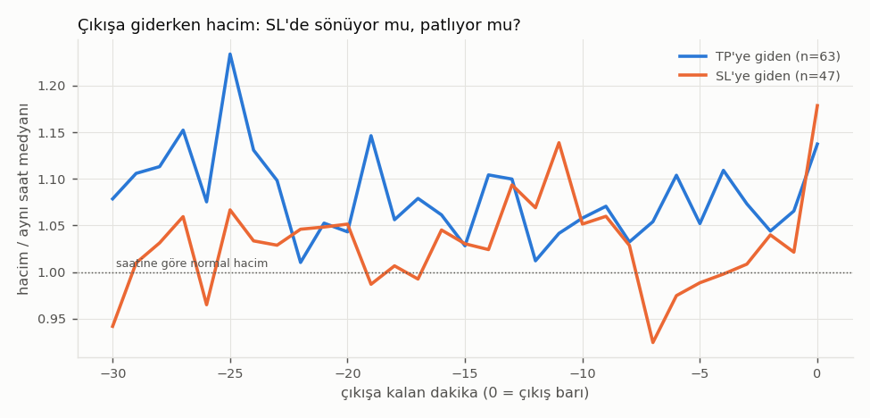
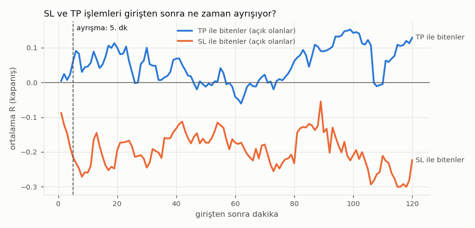
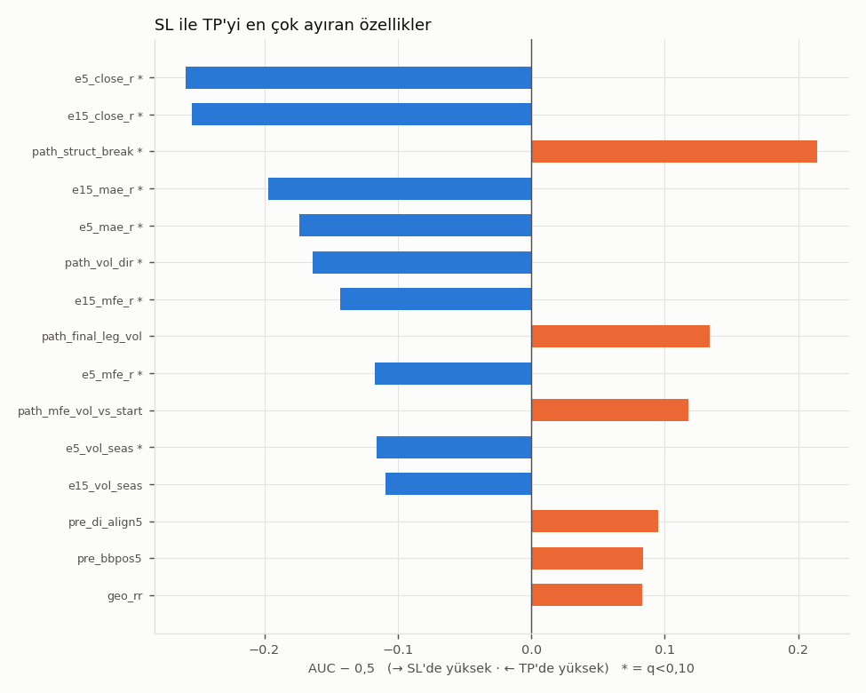

# İşlem Otopsisi — DAX

_Üretildi 2026-11-12 17:37 UTC · odak: son 140 gün · taban: 140 gün_

## 0. Güvenilirlik kapısı (önce bunu oku)
- **Saat ekseni:** ALIGNED — işlemlerin %95,5'inde giriş VE çıkış fiyatı mumla eşleşti; kayma dağılımı (saat): {-3: 96, -2: 15}. Dışlanan: 1 (#330977312: fiyat hiçbir kaymada mumla eşleşmedi)
- **Yol doğrulaması:** saf geometri yeniden oynatması gerçek TP/SL sınıfını %100,0 tuttu → güvenilir
- **Hacim verisi:** MT5 *tick* hacmi (fiyat güncelleme sayısı, borsa hacmi DEĞİL). Mevsimsel düzeltilmiş (×1 = o saat diliminde normal). Dinamik aralık p10–p90: ×0,66–×1,53
- **Bayat giriş verisi:** 1 işlemde girişten önceki son bar >10 dk eski (piyasa açılışı/boşluk)
- **Dönemler:** keşif (işlem yok) · odak 2026-06-30 → 2026-11-12 (111 işlem)
- **Komut:** `python3 -m scripts.islem_otopsi --symbol DAX --days 140 --base-days 140 --out research/dax_profesor_20261112/otopsi --trade-charts 0`

## 1. Özet
| dönem | işlem | karar | TP | SL | WR [95%] | başabaş WR | ort R [95%] | P(EV>0) | toplam R | net |
|---|---|---|---|---|---|---|---|---|---|---|
| odak | 111 | 111 | 63 | 47 | %57,7 [48–66] | %58,9 | −0,02 [−0,18…+0,16] | %43,9 | −1,67 | 2.537 $ |
| tümü | 111 | 111 | 63 | 47 | %57,7 [48–66] | %58,9 | −0,02 [−0,18…+0,16] | %43,9 | −1,67 | 2.537 $ |

_WR'ı tek başına okuma: başabaş WR = SL/(SL+TP) mesafe oranı; WR bunun üstünde değilse kâr yoktur (E14)._

**Sonuç türleri (tüm dönem):**
| outcome | n | net_usd | ort_r | medyan_sure_dk |
|---|---|---|---|---|
| TP | 63 | 17.358 $ | +0,71 | 25,88 |
| SL | 47 | −15.028 $ | −1,00 | 50,05 |
| DIGER_+ | 1 | 207 $ | +0,30 | 299,83 |

## 2. Kırılımlar — strateji, sembol-yön, seans (tüm dönem; net $'a göre en kötüden)

**Strateji ailesi**
| grup | n | karar | wr | wr_lo | wr_hi | basabas_wr | ort_r | top_r | net_usd | sl | tp |
|---|---|---|---|---|---|---|---|---|---|---|---|
| MOMSR | 41 | 41 | %53,7 | %38,7 | %67,9 | %55,2 | +0,04 | +1,53 | −415 $ | 19 | 22 |
| CEKIC | 2 | 2 | %0,0 | %0,0 | %65,8 | %16,7 | −1,00 | −2,00 | −92 $ | 2 | 0 |
| DECIDER | 30 | 30 | %53,3 | %36,1 | %69,8 | %60,2 | −0,11 | −3,41 | −10 $ | 14 | 16 |
| MANUEL | 1 | 1 | %100,0 | %20,7 | %100,0 | %64,0 | +0,30 | +0,30 | 207 $ | 0 | 0 |
| CHREV | 37 | 37 | %67,6 | %51,5 | %80,4 | %64,2 | +0,05 | +1,92 | 2.847 $ | 12 | 25 |

**Sembol · yön**
| grup | n | karar | wr | wr_lo | wr_hi | basabas_wr | ort_r | top_r | net_usd | sl | tp |
|---|---|---|---|---|---|---|---|---|---|---|---|
| GDAXI SELL | 14 | 14 | %64,3 | %38,8 | %83,7 | %64,2 | +0,00 | −0,03 | 734 $ | 5 | 9 |
| GDAXI BUY | 97 | 97 | %56,7 | %46,8 | %66,1 | %58,1 | −0,02 | −1,64 | 1.803 $ | 42 | 54 |

**Seans**
| grup | n | karar | wr | wr_lo | wr_hi | basabas_wr | ort_r | top_r | net_usd | sl | tp |
|---|---|---|---|---|---|---|---|---|---|---|---|
| AVRUPA | 54 | 54 | %57,4 | %44,2 | %69,7 | %61,9 | −0,05 | −2,72 | −1.060 $ | 23 | 31 |
| ABD | 20 | 20 | %55,0 | %34,2 | %74,2 | %58,2 | −0,14 | −2,73 | 273 $ | 9 | 11 |
| ABD_ACILIS | 12 | 12 | %66,7 | %39,1 | %86,2 | %59,8 | +0,10 | +1,25 | 329 $ | 4 | 8 |
| ASYA | 25 | 25 | %56,0 | %37,1 | %73,3 | %52,5 | +0,10 | +2,53 | 2.995 $ | 11 | 13 |

**Strateji · sembol-yön**
| grup | n | karar | wr | wr_lo | wr_hi | basabas_wr | ort_r | top_r | net_usd | sl | tp |
|---|---|---|---|---|---|---|---|---|---|---|---|
| MOMSR · GDAXI BUY | 41 | 41 | %53,7 | %38,7 | %67,9 | %55,2 | +0,04 | +1,53 | −415 $ | 19 | 22 |
| CEKIC · GDAXI BUY | 2 | 2 | %0,0 | %0,0 | %65,8 | %16,7 | −1,00 | −2,00 | −92 $ | 2 | 0 |
| DECIDER · GDAXI BUY | 30 | 30 | %53,3 | %36,1 | %69,8 | %60,2 | −0,11 | −3,41 | −10 $ | 14 | 16 |
| MANUEL · GDAXI BUY | 1 | 1 | %100,0 | %20,7 | %100,0 | %64,0 | +0,30 | +0,30 | 207 $ | 0 | 0 |
| CHREV · GDAXI SELL | 14 | 14 | %64,3 | %38,8 | %83,7 | %64,2 | +0,00 | −0,03 | 734 $ | 5 | 9 |
| CHREV · GDAXI BUY | 23 | 23 | %69,6 | %49,1 | %84,4 | %64,1 | +0,08 | +1,95 | 2.113 $ | 7 | 16 |

## 2b. Botun giriş anı rastgeleden iyi mi? (plasebo tabanı)
Her gerçek işlem için aynı sembol, yön, UTC saati ve SL/TP fiyat mesafeleriyle ±10 gün içinden 5 rastgele giriş; iki taraf da YÖNETİMSİZ oynatıldı. SL mekanizma payları rastgele girişte de benzer çıkıyorsa, o mekanizma botun hatası değil braketin (SL/TP geometrisinin) doğasıdır.

**Eşli fark (gerçek giriş − aynı geometride rastgele giriş):** ort −0,06R/işlem, %95 [−0,25…+0,13], P(fark>0) = %27,2, n=110

**Genel:**
| tur | n | wr | ort_r | sl_yon_dogru | sl_yon_yanlis | sl_hic_calismadi | sl_neredeyse_tp |
|---|---|---|---|---|---|---|---|
| gerçek_giriş | 110 | %57,3 | −0,02 | %27,7 | %17,0 | %51,1 | %17,0 |
| rastgele | 550 | %59,1 | +0,04 | %36,9 | %23,6 | %36,0 | %15,6 |

**Sembol-yön:**
| tur | side | n | wr | ort_r | sl_yon_dogru | sl_yon_yanlis | sl_hic_calismadi | sl_neredeyse_tp |
|---|---|---|---|---|---|---|---|---|
| gerçek_giriş | GDAXI BUY | 96 | %56,2 | −0,02 | %31,0 | %16,7 | %52,4 | %16,7 |
| gerçek_giriş | GDAXI SELL | 14 | %64,3 | +0,00 | %0,0 | %20,0 | %40,0 | %20,0 |
| rastgele | GDAXI BUY | 480 | %57,1 | +0,02 | %40,3 | %24,3 | %36,4 | %14,1 |
| rastgele | GDAXI SELL | 70 | %72,9 | +0,14 | %0,0 | %15,8 | %31,6 | %31,6 |

## 3. SL'ler neden oldu?
**Ana neden dağılımı (tüm dönem, tam SL'ler; öncelik sırasıyla tek kod):**
| kod | açıklama | n | pay | net_usd | ort_r |
|---|---|---|---|---|---|
| HIC_CALISMADI | işlem hiç çalışmadı (MFE<0,15R) — giriş anı yanlış; bayrakların gerçekten etkili olup olmadığı bayrak-sıklığı tablosunda | 17 | %36,2 | −7.430 $ | −1,00 |
| YON_DOGRU_ERKEN | yön doğru, zamanlama erken: önce stop, sonra hedef | 11 | %23,4 | −948 $ | −1,00 |
| GURULTU | belirgin tek neden yok — stop gürültü içinde vuruldu | 6 | %12,8 | −1.426 $ | −1,00 |
| NEREDEYSE_TP | hedefe çok yaklaşıp döndü — hedef/çıkış sorunu | 6 | %12,8 | −1.622 $ | −1,00 |
| YON_YANLIS | yön yanlıştı — stop sonrası da ters devam etti | 3 | %6,4 | −1.602 $ | −1,00 |
| HACIMLI_KIRILIM | yapı hacimli ters akışla kırıldı — gerçek karşı baskı | 2 | %4,3 | −1.157 $ | −1,00 |
| IGNE_STOP | iğne stop — yön doğruydu, tek mumluk sıçrama stopu aldı | 2 | %4,3 | −842 $ | −1,00 |

**Mekanizma payları** (bir SL birden fazla kutuya girebilir):
- Çıkış sonrası **yön doğruydu** (240 dk içinde TP seviyesine gitti): 13 (%28) · **yön yanlıştı** (≥1R daha devam): 10 (%21) · kararsız: 24 (%51)
- Yön doğru olanları yaşatacak stop medyanı: 1,74R (şu anki 1R'ye karşı — stop genişletmenin bedeli §11'de)
- Hızlı SL (≤10 dk): 7 (%15) · hiç çalışmadı (MFE<0,15R): 24 (%51) · önce kâra geçti (≥0,3R): 18 (%38) · hedefin %70'ine geldi: 8 (%17)
- Yapı kırıldı: 44 (%94) · aleyhte hacim şoku: 7 (%15) · hacim söndü: 3 (%6) · iğne stop: 8 (%17) · gece taşıma: 4 (%9) · kayma: 0 (%0)
- Medyan süre 50 dk · medyan MFE +0,14R

**Çıkış-sonrası hüküm × strateji/sembol-yön (tam SL'ler):**
| grup | KARARSIZ | YON_DOGRU | YON_YANLIS | toplam |
|---|---|---|---|---|
| MOMSR · GDAXI BUY | 7 | 6 | 6 | 19 |
| DECIDER · GDAXI BUY | 6 | 7 | 1 | 14 |
| CHREV · GDAXI BUY | 6 | 0 | 1 | 7 |
| CHREV · GDAXI SELL | 3 | 0 | 2 | 5 |
| CEKIC · GDAXI BUY | 2 | 0 | 0 | 2 |

**Bayrak sıklığı — her etiket SL'lerde mi TP'lerde mi?** `SL oranı (varken)` tabandan belirgin yüksek değilse o bayrak SL'yi AÇIKLAMAZ (TP'lerde de aynı sıklıkta vardır). Yol etiketleri teşhistir.
| etiket | evre | SL'lerde | TP'lerde | n | SL oranı (varken) | taban SL oranı | ort R (varken) | fark_pp |
|---|---|---|---|---|---|---|---|---|
| HACIMSIZ_GIRIS | giriş (karar anı) | %10,6 | %3,2 | 7 | %71,4 | %42,7 | −0,54 | +28,7 |
| GEOMETRI_ANOMALI | giriş (karar anı) | %12,8 | %6,3 | 10 | %60,0 | %42,7 | −0,44 | +17,3 |
| KAYIP_SONRASI_TEKRAR | giriş (karar anı) | %25,5 | %20,6 | 25 | %48,0 | %42,7 | −0,11 | +5,3 |
| MTF_CELISKI | giriş (karar anı) | %31,9 | %33,3 | 36 | %41,7 | %42,7 | −0,03 | −1,1 |
| TERS_TREND_1H | giriş (karar anı) | %25,5 | %28,6 | 30 | %40,0 | %42,7 | −0,05 | −2,7 |
| RSI_DIV_LEHTE | giriş (karar anı) | %23,4 | %28,6 | 29 | %37,9 | %42,7 | +0,00 | −4,8 |
| DONUS_GIRISI | giriş (karar anı) | %25,5 | %33,3 | 33 | %36,4 | %42,7 | +0,04 | −6,4 |
| HIC_CALISMADI | yol (teşhis) | %51,1 | %0,0 | 24 | %100,0 | %42,7 | −1,00 | +57,3 |
| HIZLI_SL | yol (teşhis) | %14,9 | %0,0 | 7 | %100,0 | %42,7 | −1,00 | +57,3 |
| IGNE_STOP | yol (teşhis) | %17,0 | %0,0 | 8 | %100,0 | %42,7 | −1,00 | +57,3 |
| MFE_HACIMSIZ | yol (teşhis) | %12,8 | %0,0 | 6 | %100,0 | %42,7 | −1,00 | +57,3 |
| NEREDEYSE_TP | yol (teşhis) | %17,0 | %0,0 | 8 | %100,0 | %42,7 | −1,00 | +57,3 |
| ONCE_YESIL | yol (teşhis) | %21,3 | %0,0 | 10 | %100,0 | %42,7 | −1,00 | +57,3 |
| YAPI_KIRILDI | yol (teşhis) | %93,6 | %50,8 | 76 | %57,9 | %42,7 | −0,27 | +15,2 |
| 5M_DONUS | yol (teşhis) | %93,6 | %90,5 | 101 | %43,6 | %42,7 | −0,03 | +0,8 |
| HACIMLI_SON_BACAK | yol (teşhis) | %6,4 | %6,3 | 7 | %42,9 | %42,7 | −0,13 | +0,1 |
| HACIM_SONDU | yol (teşhis) | %6,4 | %6,3 | 7 | %42,9 | %42,7 | −0,11 | +0,1 |
| GECE | yol (teşhis) | %8,5 | %9,5 | 10 | %40,0 | %42,7 | −0,02 | −2,7 |
| TERS_HACIM_SOKU | yol (teşhis) | %14,9 | %19,0 | 19 | %36,8 | %42,7 | +0,00 | −5,9 |

## 4. TP'ler nasıl oldu?
| kod | açıklama | n | pay | net_usd | ort_r |
|---|---|---|---|---|---|
| TP_TEMIZ | temiz TP: ciddi geri çekilme olmadan hedef | 28 | %44,4 | 6.918 $ | +0,65 |
| TP_NORMAL | normal TP | 21 | %33,3 | 6.916 $ | +0,67 |
| TP_ACI | acı çektiren TP: derin geri çekilmeden döndü | 11 | %17,5 | 3.131 $ | +0,89 |
| TP_SANSLI | şanslı zamanlama: derin geri çekilme + sonra SL seviyesi de görüldü | 3 | %4,8 | 392 $ | +0,96 |

- Temiz (MAE>−0,25R): 28 (%44) · acı çektiren (MAE≤−0,6R): 14 (%22) · TP sonrası ≥1R daha gitti (hedef erken): 23 (%37) · TP'den sonra SL seviyesi de görüldü (şanslı zamanlama): 23 (%37) · hacim söndü: 4 (%6)
- Medyan süre 26 dk · medyan MAE −0,30R

## 5. Hacim — SL olurken hacim düşüyor mu?
Hacim mevsimsel düzeltilmiştir: ×1,00 = o 15-dk diliminde son 10 günün medyanı. AUC = rastgele bir SL'nin değerinin rastgele bir TP'ninkinden büyük olma olasılığı (0,5 = ayrım yok).
| ölçü | SL medyan | TP medyan | AUC (SL>TP) | q | hüküm | dönem tutarlı |
|---|---|---|---|---|---|---|
| giriş öncesi 15 dk hacim (saatine göre) | 0,98 | 1,07 | 0,45 | 0,810 | yok ayrım, tesadüf düzeyinde | — |
| giriş öncesi 30 dk hacim eğimi | 0,00 | −0,03 | 0,53 | 0,858 | yok ayrım, tesadüf düzeyinde | — |
| giriş öncesi lehte/aleyhte bar hacmi (log2) | −0,01 | 0,00 | 0,51 | 0,935 | yok ayrım, tesadüf düzeyinde | — |
| ilk 15 dk hacim (hâlâ açık olanlar) | 1,10 | 1,11 | 0,39 | 0,144 | orta ayrım, tesadüf düzeyinde | — |
| ilk 15 dk lehte/aleyhte hacim (log2) | 0,01 | 0,00 | 0,49 | 0,827 | yok ayrım, tesadüf düzeyinde | — |
| işlem boyu ortalama hacim | 0,99 | 1,11 | 0,44 | 0,485 | zayıf ayrım, tesadüf düzeyinde | — |
| son üçte bir / ilk üçte bir hacim | 1,05 | 0,96 | 0,58 | 0,460 | zayıf ayrım, tesadüf düzeyinde | — |
| çıkıştan önceki 10 dk hacim | 1,02 | 1,10 | 0,45 | 0,486 | zayıf ayrım, tesadüf düzeyinde | — |
| çıkış barı hacmi | 1,18 | 1,14 | 0,56 | 0,485 | zayıf ayrım, tesadüf düzeyinde | — |
| çıkışa götüren bacak / ilk bacak hacmi | 1,06 | 0,97 | 0,63 | 0,324 | orta ayrım, tesadüf düzeyinde | — |
| en iyi noktadaki hacim / başlangıç | 1,07 | 0,94 | 0,62 | 0,320 | orta ayrım, tesadüf düzeyinde | — |
| işlem boyu lehte/aleyhte hacim (log2) | −0,01 | 0,01 | 0,34 | 0,063 | orta ayrım, çoklu-test sonrası anlamlı | — |

**Çıkıştan önceki pencereler (yalnız işlem içi barlar, medyan):**
| ölçü | SL medyan | SL n | TP medyan | TP n |
|---|---|---|---|---|
| giris_oncesi | 0,98 | 47 | 1,07 | 63 |
| hacim -30..-21 | 0,95 | 33 | 1,15 | 35 |
| hareket -30..-21 | 0,49 | 33 | 0,54 | 35 |
| hacim -20..-11 | 1,07 | 39 | 1,06 | 42 |
| hareket -20..-11 | 0,52 | 39 | 0,51 | 42 |
| hacim -10..-1 | 1,03 | 47 | 1,11 | 62 |
| hareket -10..-1 | 0,56 | 47 | 0,55 | 62 |
| hacim cikis_bari | 1,18 | 47 | 1,14 | 63 |
| hareket cikis_bari | 0,81 | 47 | 0,86 | 63 |

## 6. Kırılmalar ve uyumsuzluklar
Karar-anı olayları (`pre_`) filtre adayı olabilir; yol olayları (`path_`) yalnız teşhistir — yapı kırılımı SL'den ÖNCE geldiği için SL'lerde neredeyse tanım gereği sık görülür; asıl soru TP'lerde ne sıklıkla görülüp kurtarıldığıdır (aşağıda 'var' satırının SL oranı).
| olay | durum | n | sl_orani | ort_r | net_usd | aile |
|---|---|---|---|---|---|---|
| pre_trend_align_1h | var | 80 | %43,8 | −0,01 | 826 $ | karar anı |
| pre_trend_align_1h | yok | 30 | %40,0 | −0,05 | 1.504 $ | karar anı |
| pre_div_rsi_against | var | 3 | %66,7 | −0,48 | 139 $ | karar anı |
| pre_div_rsi_against | yok | 107 | %42,1 | +0,00 | 2.190 $ | karar anı |
| pre_div_rsi_for | var | 29 | %37,9 | +0,00 | 1.593 $ | karar anı |
| pre_div_rsi_for | yok | 81 | %44,4 | −0,02 | 737 $ | karar anı |
| pre_voldiv_against | yok | 110 | %42,7 | −0,02 | 2.330 $ | karar anı |
| pre_voldiv_for | var | 3 | %66,7 | −0,49 | 30 $ | karar anı |
| pre_voldiv_for | yok | 107 | %42,1 | +0,00 | 2.299 $ | karar anı |
| pre_sl_beyond_struct | var | 108 | %42,6 | −0,01 | 2.235 $ | karar anı |
| pre_sl_beyond_struct | yok | 2 | %50,0 | −0,22 | 95 $ | karar anı |
| path_went_green | var | 81 | %22,2 | +0,33 | 11.685 $ | yol (teşhis) |
| path_went_green | yok | 29 | %100,0 | −1,00 | −9.356 $ | yol (teşhis) |
| path_struct_break | var | 76 | %57,9 | −0,27 | −2.821 $ | yol (teşhis) |
| path_struct_break | yok | 34 | %8,8 | +0,54 | 5.150 $ | yol (teşhis) |
| path_vol_shock_adv | var | 19 | %36,8 | +0,00 | 2.125 $ | yol (teşhis) |
| path_vol_shock_adv | yok | 91 | %44,0 | −0,02 | 205 $ | yol (teşhis) |
| path_vol_shock_fav | var | 25 | %28,0 | +0,14 | 4.232 $ | yol (teşhis) |
| path_vol_shock_fav | yok | 85 | %47,1 | −0,06 | −1.902 $ | yol (teşhis) |
| path_overnight | var | 10 | %40,0 | −0,02 | 368 $ | yol (teşhis) |
| path_overnight | yok | 100 | %43,0 | −0,02 | 1.961 $ | yol (teşhis) |
| path_us_open_cross | var | 14 | %50,0 | −0,05 | −135 $ | yol (teşhis) |
| path_us_open_cross | yok | 96 | %41,7 | −0,01 | 2.465 $ | yol (teşhis) |
| ctx_prev_win | var | 65 | %40,0 | +0,05 | 3.993 $ | bağlam |
| ctx_prev_win | yok | 44 | %45,5 | −0,10 | −985 $ | bağlam |
| ctx_prev_same_dir | var | 94 | %42,6 | +0,00 | 1.413 $ | bağlam |
| ctx_prev_same_dir | yok | 15 | %40,0 | −0,07 | 1.595 $ | bağlam |

## 7. Ne zaman belli oluyor? (erken uyarı)
SL ve TP işlemleri (hâlâ açık olanlar arasında) **5. dakikada** belirgin ayrışıyor (fark +0,28R, t=4,9; TP n=54, SL n=41).

`auc_tp_yuksek` = o dakikada TP'ye gidecek bir işlemin R'sinin SL'ye gidecek olandan yüksek olma olasılığı. `R≤−x: …` = 'o dakikada R ≤ −x ise kapat' kuralının yakaladığı SL, öldürdüğü TP ve net R etkisi (bar kapanışında çıkış — hafif iyimser). ⚠ Defter M9: 50+ BE/erken-çıkış varyantı 487 işlemde elendi; buradaki pozitif bir satır da tek dönem, örneklem-içi bulgudur.
| dakika | acik_tp | acik_sl | auc_tp_yuksek | R≤−0,3: yakalanan SL | R≤−0,3: öldürülen TP | R≤−0,3: net R | R≤−0,5: yakalanan SL | R≤−0,5: öldürülen TP | R≤−0,5: net R |
|---|---|---|---|---|---|---|---|---|---|
| 5 | 54 | 41 | 0,76 | 14 | 3 | 1,83 | 9 | 0 | 3,38 |
| 10 | 43 | 40 | 0,76 | 16 | 5 | −0,88 | 8 | 2 | −1,67 |
| 15 | 38 | 36 | 0,75 | 14 | 5 | −1,81 | 5 | 0 | 2,01 |
| 30 | 31 | 31 | 0,73 | 13 | 4 | −1,60 | 8 | 2 | −0,29 |
| 60 | 22 | 20 | 0,64 | 7 | 5 | −3,35 | 3 | 2 | −2,02 |

## 8. Her şey birbirine karşı — tüm özellik kıyası (SL vs TP)
65 özellik test edildi; p<0,05'te tesadüfen beklenen ≈3,2, bulunan 8. q<0,10 (Benjamini–Hochberg, aile içinde) olan: 9. `tutarli` = keşif ve odak dönemlerinde aynı yönde ≥0,05 ayrım. Erken (`e5_/e15_`) satırlar yalnız o dakikada açık işlemleri içerir.
| feature | aile | n_sl | n_tp | med_sl | med_tp | auc | p | q | auc_disc | auc_focus | tutarli | registry |
|---|---|---|---|---|---|---|---|---|---|---|---|---|
| e5_close_r | erken 5dk | 41 | 54 | −0,16 | 0,03 | 0,24 | 0,000 | 0,002 | — | 0,24 | — |  |
| e15_close_r | erken 15dk | 36 | 38 | −0,27 | 0,04 | 0,25 | 0,000 | 0,002 | — | 0,25 | — | M9 (ELENDİ) · M6 koşullu BE |
| path_struct_break | yol (teşhis) | 47 | 63 | 1,00 | 1,00 | 0,71 | 0,000 | 0,007 | — | 0,71 | — |  |
| e15_mae_r | erken 15dk | 36 | 38 | −0,44 | −0,19 | 0,30 | 0,002 | 0,006 | — | 0,30 | — | M9 (ELENDİ) · M7 (X) |
| e5_mae_r | erken 5dk | 41 | 54 | −0,25 | −0,14 | 0,33 | 0,004 | 0,009 | — | 0,33 | — | M9 BE/kilit/erken çıkış (ELENDİ) · M7 zaman stopu (X) |
| path_vol_dir | yol (teşhis) | 39 | 47 | −0,01 | 0,01 | 0,34 | 0,009 | 0,063 | — | 0,34 | — |  |
| e15_mfe_r | erken 15dk | 36 | 38 | 0,13 | 0,19 | 0,36 | 0,041 | 0,069 | — | 0,36 | — |  |
| path_final_leg_vol | yol (teşhis) | 24 | 33 | 1,06 | 0,97 | 0,63 | 0,092 | 0,324 | — | 0,63 | — |  |
| e5_mfe_r | erken 5dk | 41 | 54 | 0,08 | 0,13 | 0,38 | 0,050 | 0,053 | — | 0,38 | — |  |
| path_mfe_vol_vs_start | yol (teşhis) | 41 | 45 | 1,07 | 0,94 | 0,62 | 0,068 | 0,320 | — | 0,62 | — |  |
| e5_vol_seas | erken 5dk | 41 | 54 | 1,01 | 1,10 | 0,38 | 0,053 | 0,053 | — | 0,38 | — |  |
| e15_vol_seas | erken 15dk | 36 | 38 | 1,10 | 1,11 | 0,39 | 0,115 | 0,144 | — | 0,39 | — |  |
| pre_di_align5 | karar anı | 47 | 63 | −9,94 | −13,86 | 0,59 | 0,090 | 0,810 | — | 0,59 | — |  |
| pre_bbpos5 | karar anı | 47 | 63 | 0,25 | 0,17 | 0,58 | 0,143 | 0,810 | — | 0,58 | — |  |
| geo_rr | geometri | 47 | 63 | 0,66 | 0,56 | 0,58 | 0,129 | 0,777 | — | 0,58 | — | OLD-20 · M8 (WR↑ para↓, E14) |
| path_vol_last_vs_first | yol (teşhis) | 40 | 44 | 1,05 | 0,96 | 0,58 | 0,209 | 0,460 | — | 0,58 | — |  |
| pre_range_pos_4h | karar anı | 47 | 63 | 0,17 | 0,13 | 0,58 | 0,177 | 0,810 | — | 0,58 | — | B5 POSITION_GATE (AKTİF, C/B) · B13 POS_TIGHT (X, E6) |
| pre_dist_ema50_5m | karar anı | 47 | 63 | −1,88 | −2,39 | 0,58 | 0,169 | 0,810 | — | 0,58 | — |  |
| pre_dist_ema20_1m | karar anı | 47 | 63 | −1,15 | −1,56 | 0,58 | 0,153 | 0,810 | — | 0,58 | — |  |
| path_t_struct_break | yol (teşhis) | 44 | 32 | 3,50 | 3,50 | 0,58 | 0,230 | 0,460 | — | 0,58 | — |  |
| pre_ret_15 | karar anı | 47 | 63 | −0,81 | −1,16 | 0,58 | 0,167 | 0,810 | — | 0,58 | — | GF-15 kovalama endeksi (C+, bota özgü) |
| pre_ret_5 | karar anı | 47 | 63 | −0,34 | −0,52 | 0,58 | 0,179 | 0,810 | — | 0,58 | — |  |
| ctx_min_since_prev | bağlam | 46 | 63 | 51,28 | 102,18 | 0,43 | 0,201 | 0,603 | — | 0,43 | — |  |
| pre_rsi1 | karar anı | 47 | 63 | 40,94 | 35,96 | 0,57 | 0,217 | 0,810 | — | 0,57 | — |  |
| path_vol_shock_fav | yol (teşhis) | 47 | 63 | 0,00 | 0,00 | 0,43 | 0,116 | 0,326 | — | 0,43 | — |  |

## 9. Kombinasyonlar (keşif amaçlı — en güçlü karar-anı özelliklerinin ikili bölmeleri)
Bu tablo seçilmiş hücreleri gösterir; çoklu karşılaştırma yükü yüksektir — tek başına önlem gerekçesi DEĞİLDİR (E12).
| hucre | n | sl_orani | taban_sl | ort_r | fark_pp |
|---|---|---|---|---|---|
| pre_bbpos5 yüksek · geo_rr yüksek | 25 | %68,0 | %42,7 | −0,21 | +25,3 |
| pre_di_align5 yüksek · geo_rr yüksek | 31 | %67,7 | %42,7 | −0,24 | +25,0 |
| pre_range_pos_4h düşük · pre_dist_ema50_5m yüksek | 8 | %62,5 | %42,7 | −0,40 | +19,8 |
| pre_di_align5 düşük · pre_dist_ema20_1m düşük | 29 | %24,1 | %42,7 | +0,22 | −18,6 |
| geo_rr yüksek · pre_dist_ema50_5m yüksek | 32 | %59,4 | %42,7 | −0,10 | +16,6 |
| geo_rr yüksek · pre_range_pos_4h yüksek | 32 | %59,4 | %42,7 | −0,10 | +16,6 |
| pre_dist_ema50_5m düşük · pre_dist_ema20_1m düşük | 36 | %27,8 | %42,7 | +0,15 | −14,9 |
| pre_di_align5 düşük · geo_rr yüksek | 24 | %29,2 | %42,7 | +0,24 | −13,6 |
| geo_rr yüksek · pre_dist_ema20_1m yüksek | 32 | %56,2 | %42,7 | −0,11 | +13,5 |
| pre_di_align5 yüksek · pre_bbpos5 yüksek | 41 | %56,1 | %42,7 | −0,18 | +13,4 |
| pre_range_pos_4h düşük · pre_dist_ema20_1m düşük | 37 | %29,7 | %42,7 | +0,13 | −13,0 |
| pre_range_pos_4h düşük · pre_dist_ema20_1m yüksek | 18 | %55,6 | %42,7 | −0,24 | +12,8 |

## 10. Aday önlemler — karar anında uygulanabilir (keşifte seçildi → odakta sınandı)
Eşikler keşif döneminin tertilinden; özellik seçimi keşif AUC'sinden. `kurtarilan_r` > `rastgele_beklenen_r` ise kural rastgele aynı sayıda işlemi elemekten iyidir. Odakta da pozitif değilse aday ELENİR. Pozitif olsa bile: GÖLGE → ≥150 olay → canlıya alma kartı (2. KURAL).
_Keşif döneminde yeterli işlem yok (her grupta ≥8) — aday üretilmedi._

## 11. Geometri karşı-olgusu (aynı girişler, farklı SL/TP — yönetimsiz)
Durum: **güvenilir** (gerçek sonucu tutma oranı %100,0, n=110). `ort_r_ayni_risk` = lot SL'ye göre ölçeklenip $ risk sabit tutulursa işlem başına R. Bot yönetimi (BE30, koştur) bu tabloda YOK.
| sl_x | tp_x | n | wr | top_r_ayni_lot | ort_r_ayni_risk | kesif_ort_r | odak_ort_r |
|---|---|---|---|---|---|---|---|
| 0,75 | 0,75 | 110 | %50,9 | −9,92 | −0,12 | — | −0,12 |
| 0,75 | 1,00 | 110 | %45,5 | −12,04 | −0,15 | — | −0,15 |
| 0,75 | 1,50 | 110 | %33,6 | −16,49 | −0,20 | — | −0,20 |
| 1,00 | 0,75 | 110 | %63,6 | +0,15 | +0,00 | — | +0,00 |
| 1,00 | 1,00 | 110 | %57,3 | −1,97 | −0,02 | — | −0,02 |
| 1,00 | 1,50 | 110 | %44,5 | −6,96 | −0,06 | — | −0,06 |
| 1,25 | 0,75 | 110 | %70,0 | +5,63 | +0,04 | — | +0,04 |
| 1,25 | 1,00 | 110 | %63,6 | +3,52 | +0,03 | — | +0,03 |
| 1,25 | 1,50 | 110 | %50,0 | −3,72 | −0,03 | — | −0,03 |
| 1,50 | 0,75 | 110 | %72,7 | +4,73 | +0,03 | — | +0,03 |
| 1,50 | 1,00 | 110 | %66,4 | +1,82 | +0,01 | — | +0,01 |
| 1,50 | 1,50 | 110 | %53,6 | −4,93 | −0,03 | — | −0,03 |
| 2,00 | 0,75 | 110 | %79,1 | +8,85 | +0,04 | — | +0,04 |
| 2,00 | 1,00 | 110 | %73,6 | +7,91 | +0,04 | — | +0,04 |
| 2,00 | 1,50 | 110 | %61,8 | +2,57 | +0,01 | — | +0,01 |

## 12. İşlem kartları — odak penceresi (111 işlem; önce SL'ler, yeniden eskiye)
#### SL · GER40 BUY · CHREV · 12.11 15:00 TSİ → 12.11 16:09 TSİ (69 dk) · −1.320 $ · −1,00R · #422374628
**Ana neden:** işlem hiç çalışmadı (MFE<0,15R) — giriş anı yanlış; bayrakların gerçekten etkili olup olmadığı bayrak-sıklığı tablosunda
- **Giriş bağlamı:** SL 5,53×ATR5, RR 0,56 (başabaş %64), 5m RSI(yön) 39, son 15 dk −0,5 ATR5, hacim ×0,88 (saatine göre)
- **Yol:** MFE +0,14R (67. dk), MAE −1,00R (68. dk), ilk gelen ±0,5R: aleyhte · en iyi nokta yalnız +0,14R · giriş öncesi yapı ucu kapanışla kırıldı (28. dk) · 5m trend aleyhe döndü (4. dk) · stop tek geniş mumun iğnesiyle alındı, mum geri kapandı
- **Çıkış sonrası (240 dk):** ne hedefe döndü ne belirgin devam etti
- **Geçmiş benzerleri:** en benzer 10 geçmiş işlemin 2'i SL (bu sembol-yönde taban SL oranı %43), ort R +0.24
- Etiketler: `5M_DONUS` `HIC_CALISMADI` `IGNE_STOP` `KARARSIZ` `YAPI_KIRILDI`

#### SL · GER40 BUY · DECIDER · 12.11 14:21 TSİ → 12.11 15:29 TSİ (69 dk) · −4 $ · −1,00R · #422352199
**Ana neden:** belirgin tek neden yok — stop gürültü içinde vuruldu
- **Giriş bağlamı:** SL 1,44×ATR5, RR 0,67 (başabaş %60), 5m RSI(yön) 40, son 15 dk −0,1 ATR5, hacim ×0,86 (saatine göre)
- **Yol:** MFE +0,18R (42. dk), MAE −1,00R (4. dk), ilk gelen ±0,5R: aleyhte · giriş öncesi yapı ucu kapanışla kırıldı (3. dk) · 5m trend aleyhe döndü (4. dk)
- **Çıkış sonrası (240 dk):** ne hedefe döndü ne belirgin devam etti
- **Geçmiş benzerleri:** en benzer 10 geçmiş işlemin 4'i SL (bu sembol-yönde taban SL oranı %43), ort R -0.02
- Etiketler: `5M_DONUS` `KARARSIZ` `YAPI_KIRILDI`

#### SL · GER40 BUY · DECIDER · 11.11 12:27 TSİ → 11.11 12:36 TSİ (10 dk) · −5 $ · −1,00R · #421458031
**Ana neden:** yön doğru, zamanlama erken: önce stop, sonra hedef
- **Giriş bağlamı:** SL 1,44×ATR5, RR 0,66 (başabaş %60), 5m RSI(yön) 35, son 15 dk −2,2 ATR5, hacim ×1,04 (saatine göre) · son 15 dk −2,2 ATR5 aleyhte gelmişti (dönüş girişi) · aynı yönde kayıptan 8 dk sonra yeniden giriş
- **Yol:** MFE +0,31R (3. dk), MAE −1,00R (8. dk), ilk gelen ±0,5R: aleyhte · 10 dk'da stop · önce +0,31R kâra geçti (3. dk) · giriş öncesi yapı ucu kapanışla kırıldı (5. dk) · 5m trend aleyhe döndü (3. dk)
- **Çıkış sonrası (240 dk):** çıkıştan sonra TP seviyesine gitti; yaşatacak stop ≈ 1,00R
- **Bayrakların geçmiş ağırlığı** (SL oranına katkı, tüm dönem): DONUS_GIRISI −6pp (etkisiz, n=33) · KAYIP_SONRASI_TEKRAR +5pp (etkisiz, n=25)
- **Geçmiş benzerleri:** en benzer 10 geçmiş işlemin 4'i SL (bu sembol-yönde taban SL oranı %43), ort R -0.01
- Etiketler: `5M_DONUS` `DONUS_GIRISI` `HIZLI_SL` `KAYIP_SONRASI_TEKRAR` `ONCE_YESIL` `YAPI_KIRILDI` `YON_DOGRU`

#### SL · GER40 BUY · MOMSR · 11.11 12:15 TSİ → 11.11 12:18 TSİ (3 dk) · −592 $ · −1,00R · #421446095
**Ana neden:** işlem hiç çalışmadı (MFE<0,15R) — giriş anı yanlış; bayrakların gerçekten etkili olup olmadığı bayrak-sıklığı tablosunda
- **Giriş bağlamı:** SL 1,99×ATR5, RR 0,66 (başabaş %60), 5m RSI(yön) 45, son 15 dk −1,6 ATR5, hacim ×0,86 (saatine göre) · son 15 dk −1,6 ATR5 aleyhte gelmişti (dönüş girişi)
- **Yol:** MFE +0,00R (1. dk), MAE −1,00R (2. dk), ilk gelen ±0,5R: aleyhte · 3 dk'da stop · en iyi nokta yalnız +0,00R · giriş öncesi yapı ucu kapanışla kırıldı (1. dk)
- **Çıkış sonrası (240 dk):** ne hedefe döndü ne belirgin devam etti
- **Bayrakların geçmiş ağırlığı** (SL oranına katkı, tüm dönem): DONUS_GIRISI −6pp (etkisiz, n=33)
- **Geçmiş benzerleri:** en benzer 10 geçmiş işlemin 2'i SL (bu sembol-yönde taban SL oranı %42), ort R +0.31
- Etiketler: `DONUS_GIRISI` `HIC_CALISMADI` `HIZLI_SL` `KARARSIZ` `YAPI_KIRILDI`

#### SL · GER40 BUY · CEKIC · 11.11 12:00 TSİ → 11.11 12:18 TSİ (19 dk) · −62 $ · −1,00R · #421440870
**Ana neden:** işlem hiç çalışmadı (MFE<0,15R) — giriş anı yanlış; bayrakların gerçekten etkili olup olmadığı bayrak-sıklığı tablosunda [giriş bayrakları: RSI_DIV_KARSI]
- **Giriş bağlamı:** SL 4,23×ATR5, RR 5,00 (başabaş %17), 5m RSI(yön) 56, son 15 dk −0,6 ATR5, hacim ×0,84 (saatine göre) · RSI diverjansı işlemin ALEYHİNE (fiyat yeni uç, RSI teyit etmiyor) · olağan dışı kurulum: RR 5,00 (başabaş %17), SL 4,2×ATR5 — tasarım mı, besleme/fiyat-tabanı hatası mı kontrol et (defter E21)
- **Yol:** MFE +0,03R (4. dk), MAE −1,00R (17. dk), ilk gelen ±0,5R: aleyhte · en iyi nokta yalnız +0,03R · giriş öncesi yapı ucu kapanışla kırıldı (13. dk) · 5m trend aleyhe döndü (10. dk)
- **Çıkış sonrası (240 dk):** ne hedefe döndü ne belirgin devam etti
- **Bayrakların geçmiş ağırlığı** (SL oranına katkı, tüm dönem): GEOMETRI_ANOMALI (az örnek) · RSI_DIV_KARSI (az örnek)
- **Geçmiş benzerleri:** en benzer 10 geçmiş işlemin 5'i SL (bu sembol-yönde taban SL oranı %42), ort R +0.09
- Etiketler: `5M_DONUS` `GEOMETRI_ANOMALI` `HIC_CALISMADI` `KARARSIZ` `RSI_DIV_KARSI` `YAPI_KIRILDI`

#### SL · GER40 BUY · CEKIC · 10.11 08:00 TSİ → 10.11 17:52 TSİ (592 dk) · −30 $ · −1,00R · #420513148
**Ana neden:** belirgin tek neden yok — stop gürültü içinde vuruldu
- **Giriş bağlamı:** SL 4,76×ATR5, RR 5,00 (başabaş %17), 5m RSI(yön) 60, son 15 dk +0,9 ATR5, hacim ×0,71 (saatine göre) · 4s aralığın yön tarafındaki ucunda (%97) · olağan dışı kurulum: RR 5,00 (başabaş %17), SL 4,8×ATR5 — tasarım mı, besleme/fiyat-tabanı hatası mı kontrol et (defter E21)
- **Yol:** MFE +2,77R (376. dk), MAE −1,00R (587. dk), ilk gelen ±0,5R: lehte · önce +2,77R kâra geçti (376. dk) · giriş öncesi yapı ucu kapanışla kırıldı (586. dk) · 5m trend aleyhe döndü (99. dk) · stop tek geniş mumun iğnesiyle alındı, mum geri kapandı
- **Çıkış sonrası (240 dk):** ne hedefe döndü ne belirgin devam etti
- **Bayrakların geçmiş ağırlığı** (SL oranına katkı, tüm dönem): GEOMETRI_ANOMALI (az örnek) · UCTA_GIRIS (az örnek)
- **Geçmiş benzerleri:** en benzer 10 geçmiş işlemin 4'i SL (bu sembol-yönde taban SL oranı %42), ort R +0.52
- Etiketler: `5M_DONUS` `GEOMETRI_ANOMALI` `IGNE_STOP` `KARARSIZ` `ONCE_YESIL` `UCTA_GIRIS` `YAPI_KIRILDI`

#### SL · GER40 BUY · DECIDER · 03.11 20:02 TSİ → 03.11 22:53 TSİ (171 dk) · −4 $ · −1,00R · #415500637
**Ana neden:** hedefe çok yaklaşıp döndü — hedef/çıkış sorunu
- **Giriş bağlamı:** SL 1,44×ATR5, RR 0,67 (başabaş %60), 5m RSI(yön) 38, son 15 dk +0,2 ATR5, hacim ×1,53 (saatine göre)
- **Yol:** MFE +0,59R (93. dk), MAE −1,00R (158. dk), ilk gelen ±0,5R: aleyhte · hedefin %88'ine geldi · giriş öncesi yapı ucu kapanışla kırıldı (31. dk) · aleyhte hacim şoku (88. dk) · 5m trend aleyhe döndü (2. dk)
- **Çıkış sonrası (240 dk):** ne hedefe döndü ne belirgin devam etti
- **Geçmiş benzerleri:** en benzer 10 geçmiş işlemin 6'i SL (bu sembol-yönde taban SL oranı %43), ort R -0.33
- Etiketler: `5M_DONUS` `KARARSIZ` `NEREDEYSE_TP` `TERS_HACIM_SOKU` `YAPI_KIRILDI`

#### SL · GER40 BUY · DECIDER · 30.10 20:47 TSİ → 30.10 21:17 TSİ (30 dk) · −3 $ · −1,00R · #413773345
**Ana neden:** yön doğru, zamanlama erken: önce stop, sonra hedef
- **Giriş bağlamı:** SL 1,48×ATR5, RR 0,67 (başabaş %60), 5m RSI(yön) 34, son 15 dk −0,9 ATR5, hacim ×1,43 (saatine göre) · 1h EMA50'nin ters tarafında (−1,5 ATR1h) · 4 zaman diliminin yalnız 1'i yönle uyumlu · aynı yönde kayıptan 11 dk sonra yeniden giriş
- **Yol:** MFE +0,17R (1. dk), MAE −1,00R (29. dk), ilk gelen ±0,5R: aleyhte · giriş öncesi yapı ucu kapanışla kırıldı (3. dk) · 5m trend aleyhe döndü (3. dk) · en iyi noktaya sönen hacimle ulaştı (itki tükendi)
- **Çıkış sonrası (240 dk):** çıkıştan sonra TP seviyesine gitti; yaşatacak stop ≈ 3,05R
- **Bayrakların geçmiş ağırlığı** (SL oranına katkı, tüm dönem): KAYIP_SONRASI_TEKRAR +5pp (etkisiz, n=25) · MTF_CELISKI −1pp (etkisiz, n=36) · TERS_TREND_1H −3pp (etkisiz, n=30)
- **Geçmiş benzerleri:** en benzer 10 geçmiş işlemin 4'i SL (bu sembol-yönde taban SL oranı %42), ort R -0.01
- Etiketler: `5M_DONUS` `KAYIP_SONRASI_TEKRAR` `MFE_HACIMSIZ` `MTF_CELISKI` `TERS_TREND_1H` `YAPI_KIRILDI` `YON_DOGRU`

#### SL · GER40 BUY · DECIDER · 30.10 20:05 TSİ → 30.10 20:36 TSİ (30 dk) · −3 $ · −1,00R · #413751195
**Ana neden:** işlem hiç çalışmadı (MFE<0,15R) — giriş anı yanlış; bayrakların gerçekten etkili olup olmadığı bayrak-sıklığı tablosunda [giriş bayrakları: TERS_TREND_1H, MTF_CELISKI, KAYIP_SONRASI_TEKRAR]
- **Giriş bağlamı:** SL 1,46×ATR5, RR 0,62 (başabaş %62), 5m RSI(yön) 35, son 15 dk −0,8 ATR5, hacim ×1,48 (saatine göre) · 1h EMA50'nin ters tarafında (−1,1 ATR1h) · 4 zaman diliminin yalnız 1'i yönle uyumlu · RSI diverjansı işlemin LEHİNE (aleyhte uç RSI'da teyitsiz) · aynı yönde kayıptan 19 dk sonra yeniden giriş
- **Yol:** MFE +0,00R (1. dk), MAE −1,00R (30. dk), ilk gelen ±0,5R: aleyhte · en iyi nokta yalnız +0,00R · giriş öncesi yapı ucu kapanışla kırıldı (1. dk) · 5m trend aleyhe döndü (4. dk)
- **Çıkış sonrası (240 dk):** ne hedefe döndü ne belirgin devam etti
- **Bayrakların geçmiş ağırlığı** (SL oranına katkı, tüm dönem): KAYIP_SONRASI_TEKRAR +5pp (etkisiz, n=25) · MTF_CELISKI −1pp (etkisiz, n=36) · RSI_DIV_LEHTE −5pp (etkisiz, n=29) · TERS_TREND_1H −3pp (etkisiz, n=30)
- **Geçmiş benzerleri:** en benzer 10 geçmiş işlemin 4'i SL (bu sembol-yönde taban SL oranı %41), ort R -0.01
- Etiketler: `5M_DONUS` `HIC_CALISMADI` `KARARSIZ` `KAYIP_SONRASI_TEKRAR` `MTF_CELISKI` `RSI_DIV_LEHTE` `TERS_TREND_1H` `YAPI_KIRILDI`

#### SL · GER40 BUY · DECIDER · 30.10 19:04 TSİ → 30.10 19:46 TSİ (42 dk) · −4 $ · −1,00R · #413723890
**Ana neden:** hedefe çok yaklaşıp döndü — hedef/çıkış sorunu
- **Giriş bağlamı:** SL 1,53×ATR5, RR 0,67 (başabaş %60), 5m RSI(yön) 43, son 15 dk −0,9 ATR5, hacim ×1,85 (saatine göre) · 1h EMA50'nin ters tarafında (−0,6 ATR1h) · 4 zaman diliminin yalnız 1'i yönle uyumlu · RSI diverjansı işlemin LEHİNE (aleyhte uç RSI'da teyitsiz)
- **Yol:** MFE +0,63R (36. dk), MAE −1,00R (8. dk), ilk gelen ±0,5R: aleyhte · hedefin %94'ine geldi · giriş öncesi yapı ucu kapanışla kırıldı (3. dk) · 5m trend aleyhe döndü (0. dk) · işlem boyunca hacim söndü (son/ilk üçte bir ×0,61) · en iyi noktaya sönen hacimle ulaştı (itki tükendi) · stop tek geniş mumun iğnesiyle alındı, mum geri kapandı
- **Çıkış sonrası (240 dk):** SL'den sonra −4,56R'ye kadar devam etti
- **Bayrakların geçmiş ağırlığı** (SL oranına katkı, tüm dönem): MTF_CELISKI −1pp (etkisiz, n=36) · RSI_DIV_LEHTE −5pp (etkisiz, n=29) · TERS_TREND_1H −3pp (etkisiz, n=30)
- **Geçmiş benzerleri:** en benzer 10 geçmiş işlemin 4'i SL (bu sembol-yönde taban SL oranı %41), ort R -0.01
- Etiketler: `5M_DONUS` `HACIM_SONDU` `IGNE_STOP` `MFE_HACIMSIZ` `MTF_CELISKI` `NEREDEYSE_TP` `RSI_DIV_LEHTE` `TERS_TREND_1H` `YAPI_KIRILDI` `YON_YANLIS`

#### SL · GER40 BUY · DECIDER · 30.10 12:55 TSİ → 30.10 13:31 TSİ (35 dk) · −4 $ · −1,00R · #413430564
**Ana neden:** belirgin tek neden yok — stop gürültü içinde vuruldu
- **Giriş bağlamı:** SL 1,43×ATR5, RR 0,66 (başabaş %60), 5m RSI(yön) 38, son 15 dk −0,6 ATR5, hacim ×1,13 (saatine göre) · 4 zaman diliminin yalnız 1'i yönle uyumlu
- **Yol:** MFE +0,35R (4. dk), MAE −1,00R (35. dk), ilk gelen ±0,5R: aleyhte · önce +0,35R kâra geçti (4. dk) · giriş öncesi yapı ucu kapanışla kırıldı (6. dk) · 5m trend aleyhe döndü (4. dk)
- **Çıkış sonrası (240 dk):** ne hedefe döndü ne belirgin devam etti
- **Bayrakların geçmiş ağırlığı** (SL oranına katkı, tüm dönem): MTF_CELISKI −1pp (etkisiz, n=36)
- **Geçmiş benzerleri:** en benzer 10 geçmiş işlemin 3'i SL (bu sembol-yönde taban SL oranı %41), ort R +0.13
- Etiketler: `5M_DONUS` `KARARSIZ` `MTF_CELISKI` `ONCE_YESIL` `YAPI_KIRILDI`

#### SL · GER40 BUY · MOMSR · 29.10 21:31 TSİ → 30.10 04:03 TSİ (391 dk) · −459 $ · −1,00R · #412979338
**Ana neden:** hedefe çok yaklaşıp döndü — hedef/çıkış sorunu
- **Giriş bağlamı:** SL 2,03×ATR5, RR 1,79 (başabaş %36), 5m RSI(yön) 48, son 15 dk −1,2 ATR5, hacim ×1,13 (saatine göre)
- **Yol:** MFE +1,71R (90. dk), MAE −1,00R (195. dk), ilk gelen ±0,5R: lehte · hedefin %95'ine geldi · giriş öncesi yapı ucu kapanışla kırıldı (99. dk) · aleyhte hacim şoku (90. dk) · 5m trend aleyhe döndü (3. dk) · günlük kapanışı (17:00 NY) geçti, swap −40,05 $
- **Çıkış sonrası (240 dk):** SL'den sonra −3,33R'ye kadar devam etti
- **Geçmiş benzerleri:** en benzer 10 geçmiş işlemin 4'i SL (bu sembol-yönde taban SL oranı %42), ort R +0.16
- Etiketler: `5M_DONUS` `GECE` `NEREDEYSE_TP` `TERS_HACIM_SOKU` `YAPI_KIRILDI` `YON_YANLIS`

#### SL · GER40 BUY · DECIDER · 23.10 17:15 TSİ → 23.10 17:27 TSİ (12 dk) · −5 $ · −1,00R · #409488588
**Ana neden:** yön doğru, zamanlama erken: önce stop, sonra hedef
- **Giriş bağlamı:** SL 1,50×ATR5, RR 0,67 (başabaş %60), 5m RSI(yön) 35, son 15 dk −2,3 ATR5, hacim ×1,14 (saatine göre) · son 15 dk −2,3 ATR5 aleyhte gelmişti (dönüş girişi) · 1h EMA50'nin ters tarafında (−3,8 ATR1h) · 4 zaman diliminin yalnız 0'i yönle uyumlu
- **Yol:** MFE +0,00R (1. dk), MAE −1,00R (3. dk), ilk gelen ±0,5R: aleyhte · en iyi nokta yalnız +0,00R · giriş öncesi yapı ucu kapanışla kırıldı (1. dk) · 5m trend aleyhe döndü (5. dk)
- **Çıkış sonrası (240 dk):** çıkıştan sonra TP seviyesine gitti; yaşatacak stop ≈ 1,22R
- **Bayrakların geçmiş ağırlığı** (SL oranına katkı, tüm dönem): DONUS_GIRISI −6pp (etkisiz, n=33) · MTF_CELISKI −1pp (etkisiz, n=36) · TERS_TREND_1H −3pp (etkisiz, n=30)
- **Geçmiş benzerleri:** en benzer 10 geçmiş işlemin 4'i SL (bu sembol-yönde taban SL oranı %43), ort R -0.03
- Etiketler: `5M_DONUS` `DONUS_GIRISI` `HIC_CALISMADI` `MTF_CELISKI` `TERS_TREND_1H` `YAPI_KIRILDI` `YON_DOGRU`

#### SL · GER40 BUY · DECIDER · 23.10 16:12 TSİ → 23.10 16:32 TSİ (20 dk) · −4 $ · −1,00R · #409417979
**Ana neden:** yön doğru, zamanlama erken: önce stop, sonra hedef
- **Giriş bağlamı:** SL 1,42×ATR5, RR 0,67 (başabaş %60), 5m RSI(yön) 38, son 15 dk −0,5 ATR5, hacim ×1,08 (saatine göre) · 1h EMA50'nin ters tarafında (−3,2 ATR1h) · 4 zaman diliminin yalnız 0'i yönle uyumlu · RSI diverjansı işlemin LEHİNE (aleyhte uç RSI'da teyitsiz)
- **Yol:** MFE +0,16R (16. dk), MAE −1,00R (19. dk), ilk gelen ±0,5R: aleyhte · giriş öncesi yapı ucu kapanışla kırıldı (3. dk) · 5m trend aleyhe döndü (2. dk)
- **Çıkış sonrası (240 dk):** çıkıştan sonra TP seviyesine gitti; yaşatacak stop ≈ 1,20R
- **Bayrakların geçmiş ağırlığı** (SL oranına katkı, tüm dönem): MTF_CELISKI −1pp (etkisiz, n=36) · RSI_DIV_LEHTE −5pp (etkisiz, n=29) · TERS_TREND_1H −3pp (etkisiz, n=30)
- **Geçmiş benzerleri:** en benzer 10 geçmiş işlemin 4'i SL (bu sembol-yönde taban SL oranı %43), ort R -0.04
- Etiketler: `5M_DONUS` `MTF_CELISKI` `RSI_DIV_LEHTE` `TERS_TREND_1H` `YAPI_KIRILDI` `YON_DOGRU`

#### SL · GER40 BUY · DECIDER · 23.10 12:07 TSİ → 23.10 12:35 TSİ (28 dk) · −5 $ · −1,00R · #409264094
**Ana neden:** işlem hiç çalışmadı (MFE<0,15R) — giriş anı yanlış; bayrakların gerçekten etkili olup olmadığı bayrak-sıklığı tablosunda [giriş bayrakları: TERS_TREND_1H, MTF_CELISKI]
- **Giriş bağlamı:** SL 1,45×ATR5, RR 0,67 (başabaş %60), 5m RSI(yön) 37, son 15 dk −1,9 ATR5, hacim ×1,24 (saatine göre) · son 15 dk −1,9 ATR5 aleyhte gelmişti (dönüş girişi) · 1h EMA50'nin ters tarafında (−2,5 ATR1h) · 4 zaman diliminin yalnız 0'i yönle uyumlu
- **Yol:** MFE +0,14R (13. dk), MAE −1,00R (27. dk), ilk gelen ±0,5R: aleyhte · en iyi nokta yalnız +0,14R · giriş öncesi yapı ucu kapanışla kırıldı (1. dk) · 5m trend aleyhe döndü (2. dk)
- **Çıkış sonrası (240 dk):** ne hedefe döndü ne belirgin devam etti
- **Bayrakların geçmiş ağırlığı** (SL oranına katkı, tüm dönem): DONUS_GIRISI −6pp (etkisiz, n=33) · MTF_CELISKI −1pp (etkisiz, n=36) · TERS_TREND_1H −3pp (etkisiz, n=30)
- **Geçmiş benzerleri:** en benzer 10 geçmiş işlemin 3'i SL (bu sembol-yönde taban SL oranı %43), ort R +0.11
- Etiketler: `5M_DONUS` `DONUS_GIRISI` `HIC_CALISMADI` `KARARSIZ` `MTF_CELISKI` `TERS_TREND_1H` `YAPI_KIRILDI`

#### SL · GER40 BUY · DECIDER · 22.10 09:20 TSİ → 22.10 09:23 TSİ (2 dk) · −3 $ · −1,00R · #408210983
**Ana neden:** yön doğru, zamanlama erken: önce stop, sonra hedef
- **Giriş bağlamı:** SL 1,42×ATR5, RR 0,67 (başabaş %60), 5m RSI(yön) 34, son 15 dk −0,1 ATR5, hacim ×1,38 (saatine göre) · 4 zaman diliminin yalnız 1'i yönle uyumlu · RSI diverjansı işlemin LEHİNE (aleyhte uç RSI'da teyitsiz) · aynı yönde kayıptan 19 dk sonra yeniden giriş
- **Yol:** MFE +0,00R (1. dk), MAE −1,00R (2. dk), ilk gelen ±0,5R: aleyhte · 2 dk'da stop · en iyi nokta yalnız +0,00R · giriş öncesi yapı ucu kapanışla kırıldı (2. dk)
- **Çıkış sonrası (240 dk):** çıkıştan sonra TP seviyesine gitti; yaşatacak stop ≈ 2,26R
- **Bayrakların geçmiş ağırlığı** (SL oranına katkı, tüm dönem): KAYIP_SONRASI_TEKRAR +5pp (etkisiz, n=25) · MTF_CELISKI −1pp (etkisiz, n=36) · RSI_DIV_LEHTE −5pp (etkisiz, n=29)
- **Geçmiş benzerleri:** en benzer 10 geçmiş işlemin 3'i SL (bu sembol-yönde taban SL oranı %43), ort R +0.05
- Etiketler: `HIC_CALISMADI` `HIZLI_SL` `KAYIP_SONRASI_TEKRAR` `MTF_CELISKI` `RSI_DIV_LEHTE` `YAPI_KIRILDI` `YON_DOGRU`

#### SL · GER40 BUY · DECIDER · 22.10 08:59 TSİ → 22.10 09:01 TSİ (2 dk) · −3 $ · −1,00R · #408189230
**Ana neden:** işlem hiç çalışmadı (MFE<0,15R) — giriş anı yanlış; bayrakların gerçekten etkili olup olmadığı bayrak-sıklığı tablosunda [giriş bayrakları: MTF_CELISKI]
- **Giriş bağlamı:** SL 1,53×ATR5, RR 0,67 (başabaş %60), 5m RSI(yön) 28, son 15 dk −0,8 ATR5, hacim ×1,65 (saatine göre) · 4 zaman diliminin yalnız 1'i yönle uyumlu · SL 30 dk yapı ucunun İÇİNDE (−0,3 ATR1)
- **Yol:** MFE +0,06R (1. dk), MAE −1,00R (1. dk), ilk gelen ±0,5R: aleyhte · 2 dk'da stop · en iyi nokta yalnız +0,06R · 5m trend aleyhe döndü (0. dk)
- **Çıkış sonrası (240 dk):** ne hedefe döndü ne belirgin devam etti
- **Bayrakların geçmiş ağırlığı** (SL oranına katkı, tüm dönem): MTF_CELISKI −1pp (etkisiz, n=36) · STOP_YAPI_ICINDE (az örnek)
- **Geçmiş benzerleri:** en benzer 10 geçmiş işlemin 4'i SL (bu sembol-yönde taban SL oranı %42), ort R -0.08
- Etiketler: `5M_DONUS` `HIC_CALISMADI` `HIZLI_SL` `KARARSIZ` `MTF_CELISKI` `STOP_YAPI_ICINDE`

#### SL · GER40 BUY · DECIDER · 16.10 08:55 TSİ → 16.10 09:00 TSİ (5 dk) · −2 $ · −1,00R · #404875189
**Ana neden:** yön doğru, zamanlama erken: önce stop, sonra hedef
- **Giriş bağlamı:** SL 1,38×ATR5, RR 0,66 (başabaş %60), 5m RSI(yön) 43, son 15 dk +0,7 ATR5, hacim ×0,81 (saatine göre) · RSI diverjansı işlemin LEHİNE (aleyhte uç RSI'da teyitsiz) · aynı yönde kayıptan 29 dk sonra yeniden giriş
- **Yol:** MFE +0,39R (2. dk), MAE −1,00R (3. dk), ilk gelen ±0,5R: yok · 5 dk'da stop · önce +0,39R kâra geçti (2. dk) · 5m trend aleyhe döndü (5. dk)
- **Çıkış sonrası (240 dk):** çıkıştan sonra TP seviyesine gitti; yaşatacak stop ≈ 4,57R
- **Bayrakların geçmiş ağırlığı** (SL oranına katkı, tüm dönem): KAYIP_SONRASI_TEKRAR +5pp (etkisiz, n=25) · RSI_DIV_LEHTE −5pp (etkisiz, n=29)
- **Geçmiş benzerleri:** en benzer 10 geçmiş işlemin 4'i SL (bu sembol-yönde taban SL oranı %41), ort R -0.06
- Etiketler: `5M_DONUS` `HIZLI_SL` `KAYIP_SONRASI_TEKRAR` `ONCE_YESIL` `RSI_DIV_LEHTE` `YON_DOGRU`

#### SL · GER40 BUY · DECIDER · 16.10 08:14 TSİ → 16.10 08:26 TSİ (12 dk) · −2 $ · −1,00R · #404857721
**Ana neden:** yön doğru, zamanlama erken: önce stop, sonra hedef
- **Giriş bağlamı:** SL 1,41×ATR5, RR 0,66 (başabaş %60), 5m RSI(yön) 43, son 15 dk −1,1 ATR5, hacim ×0,60 (saatine göre) · aleyhte uç sönen hacimle (satış/alış tükenmesi) · giriş öncesi hacim saatine göre düşük (×0,60)
- **Yol:** MFE +0,01R (2. dk), MAE −1,00R (8. dk), ilk gelen ±0,5R: aleyhte · en iyi nokta yalnız +0,01R · giriş öncesi yapı ucu kapanışla kırıldı (4. dk) · 5m trend aleyhe döndü (0. dk)
- **Çıkış sonrası (240 dk):** çıkıştan sonra TP seviyesine gitti; yaşatacak stop ≈ 5,59R
- **Bayrakların geçmiş ağırlığı** (SL oranına katkı, tüm dönem): HACIMSIZ_GIRIS (az örnek) · TUKENME_LEHTE (az örnek)
- **Geçmiş benzerleri:** en benzer 10 geçmiş işlemin 4'i SL (bu sembol-yönde taban SL oranı %40), ort R -0.08
- Etiketler: `5M_DONUS` `HACIMSIZ_GIRIS` `HIC_CALISMADI` `TUKENME_LEHTE` `YAPI_KIRILDI` `YON_DOGRU`

#### SL · GER40 BUY · MOMSR · 13.10 17:09 TSİ → 13.10 17:58 TSİ (49 dk) · −487 $ · −1,00R · #402393066
**Ana neden:** belirgin tek neden yok — stop gürültü içinde vuruldu
- **Giriş bağlamı:** SL 2,01×ATR5, RR 1,54 (başabaş %39), 5m RSI(yön) 41, son 15 dk −1,7 ATR5, hacim ×0,88 (saatine göre) · son 15 dk −1,7 ATR5 aleyhte gelmişti (dönüş girişi)
- **Yol:** MFE +0,47R (2. dk), MAE −1,00R (48. dk), ilk gelen ±0,5R: aleyhte · önce +0,47R kâra geçti (2. dk) · giriş öncesi yapı ucu kapanışla kırıldı (6. dk) · 5m trend aleyhe döndü (0. dk)
- **Çıkış sonrası (240 dk):** ne hedefe döndü ne belirgin devam etti
- **Bayrakların geçmiş ağırlığı** (SL oranına katkı, tüm dönem): DONUS_GIRISI −6pp (etkisiz, n=33)
- **Geçmiş benzerleri:** en benzer 10 geçmiş işlemin 6'i SL (bu sembol-yönde taban SL oranı %39), ort R -0.31
- Etiketler: `5M_DONUS` `DONUS_GIRISI` `KARARSIZ` `ONCE_YESIL` `YAPI_KIRILDI`

#### SL · GER40 BUY · MOMSR · 12.10 18:23 TSİ → 13.10 03:45 TSİ (562 dk) · −479 $ · −1,00R · #401649063
**Ana neden:** yapı hacimli ters akışla kırıldı — gerçek karşı baskı
- **Giriş bağlamı:** SL 2,06×ATR5, RR 1,70 (başabaş %37), 5m RSI(yön) 48, son 15 dk +0,2 ATR5, hacim ×0,66 (saatine göre)
- **Yol:** MFE +1,06R (20. dk), MAE −1,00R (275. dk), ilk gelen ±0,5R: lehte · önce +1,06R kâra geçti (20. dk) · giriş öncesi yapı ucu kapanışla kırıldı (208. dk) · aleyhte hacim şoku (296. dk) · 5m trend aleyhe döndü (2. dk) · en iyi noktaya sönen hacimle ulaştı (itki tükendi) · günlük kapanışı (17:00 NY) geçti, swap −38,68 $
- **Çıkış sonrası (240 dk):** ne hedefe döndü ne belirgin devam etti
- **Geçmiş benzerleri:** en benzer 10 geçmiş işlemin 4'i SL (bu sembol-yönde taban SL oranı %39), ort R +0.25
- Etiketler: `5M_DONUS` `GECE` `KARARSIZ` `MFE_HACIMSIZ` `ONCE_YESIL` `TERS_HACIM_SOKU` `YAPI_KIRILDI`

#### SL · GER40 BUY · MOMSR · 28.08 13:44 TSİ → 28.08 13:49 TSİ (5 dk) · −185 $ · −1,00R · #368110300
**Ana neden:** yön doğru, zamanlama erken: önce stop, sonra hedef
- **Giriş bağlamı:** SL 1,99×ATR5, RR 2,11 (başabaş %32), 5m RSI(yön) 50, son 15 dk +0,1 ATR5, hacim ×0,98 (saatine göre)
- **Yol:** MFE +0,00R (1. dk), MAE −1,00R (4. dk), ilk gelen ±0,5R: aleyhte · 5 dk'da stop · en iyi nokta yalnız +0,00R · giriş öncesi yapı ucu kapanışla kırıldı (3. dk) · 5m trend aleyhe döndü (1. dk)
- **Çıkış sonrası (240 dk):** çıkıştan sonra TP seviyesine gitti; yaşatacak stop ≈ 1,03R
- **Geçmiş benzerleri:** en benzer 10 geçmiş işlemin 3'i SL (bu sembol-yönde taban SL oranı %42), ort R +0.37
- Etiketler: `5M_DONUS` `HIC_CALISMADI` `HIZLI_SL` `YAPI_KIRILDI` `YON_DOGRU`

#### SL · GER40 BUY · MOMSR · 26.08 17:23 TSİ → 26.08 18:15 TSİ (52 dk) · −247 $ · −1,00R · #366682748
**Ana neden:** yön yanlıştı — stop sonrası da ters devam etti
- **Giriş bağlamı:** SL 1,98×ATR5, RR 0,47 (başabaş %68), 5m RSI(yön) 49, son 15 dk −1,0 ATR5, hacim ×0,88 (saatine göre)
- **Yol:** MFE +0,32R (17. dk), MAE −1,00R (51. dk), ilk gelen ±0,5R: aleyhte · önce +0,32R kâra geçti (17. dk) · giriş öncesi yapı ucu kapanışla kırıldı (1. dk) · 5m trend aleyhe döndü (1. dk)
- **Çıkış sonrası (240 dk):** SL'den sonra −3,28R'ye kadar devam etti
- **Geçmiş benzerleri:** en benzer 10 geçmiş işlemin 4'i SL (bu sembol-yönde taban SL oranı %41), ort R -0.12
- Etiketler: `5M_DONUS` `ONCE_YESIL` `YAPI_KIRILDI` `YON_YANLIS`

#### SL · GER40 BUY · MOMSR · 26.08 03:22 TSİ → 26.08 10:27 TSİ (425 dk) · −175 $ · −1,00R · #366160991
**Ana neden:** yön doğru, zamanlama erken: önce stop, sonra hedef
- **Giriş bağlamı:** SL 2,79×ATR5, RR 2,23 (başabaş %31), 5m RSI(yön) 48, son 15 dk −1,2 ATR5, hacim ×1,28 (saatine göre)
- **Yol:** MFE +1,68R (155. dk), MAE −1,00R (413. dk), ilk gelen ±0,5R: aleyhte · hedefin %75'ine geldi · giriş öncesi yapı ucu kapanışla kırıldı (1. dk) · aleyhte hacim şoku (203. dk) · 5m trend aleyhe döndü (2. dk) · en iyi noktaya sönen hacimle ulaştı (itki tükendi)
- **Çıkış sonrası (240 dk):** çıkıştan sonra TP seviyesine gitti; yaşatacak stop ≈ 1,74R
- **Geçmiş benzerleri:** en benzer 10 geçmiş işlemin 5'i SL (bu sembol-yönde taban SL oranı %40), ort R +0.09
- Etiketler: `5M_DONUS` `MFE_HACIMSIZ` `NEREDEYSE_TP` `TERS_HACIM_SOKU` `YAPI_KIRILDI` `YON_DOGRU`

#### SL · GER40 BUY · MOMSR · 11.08 18:20 TSİ → 11.08 20:23 TSİ (123 dk) · −224 $ · −1,00R · #356854438
**Ana neden:** belirgin tek neden yok — stop gürültü içinde vuruldu
- **Giriş bağlamı:** SL 2,05×ATR5, RR 1,73 (başabaş %37), 5m RSI(yön) 41, son 15 dk −2,4 ATR5, hacim ×1,86 (saatine göre) · son 15 dk −2,4 ATR5 aleyhte gelmişti (dönüş girişi)
- **Yol:** MFE +0,20R (2. dk), MAE −1,00R (115. dk), ilk gelen ±0,5R: aleyhte · giriş öncesi yapı ucu kapanışla kırıldı (2. dk) · 5m trend aleyhe döndü (5. dk)
- **Çıkış sonrası (240 dk):** ne hedefe döndü ne belirgin devam etti
- **Bayrakların geçmiş ağırlığı** (SL oranına katkı, tüm dönem): DONUS_GIRISI −6pp (etkisiz, n=33)
- **Geçmiş benzerleri:** en benzer 10 geçmiş işlemin 5'i SL (bu sembol-yönde taban SL oranı %41), ort R -0.21
- Etiketler: `5M_DONUS` `DONUS_GIRISI` `KARARSIZ` `YAPI_KIRILDI`

#### SL · GER40 SELL · CHREV · 11.08 14:55 TSİ → 11.08 17:47 TSİ (172 dk) · −687 $ · −1,00R · #356707574
**Ana neden:** işlem hiç çalışmadı (MFE<0,15R) — giriş anı yanlış; bayrakların gerçekten etkili olup olmadığı bayrak-sıklığı tablosunda [giriş bayrakları: TERS_TREND_1H, MTF_CELISKI]
- **Giriş bağlamı:** SL 6,65×ATR5, RR 0,56 (başabaş %64), 5m RSI(yön) 30, son 15 dk −0,9 ATR5, hacim ×1,91 (saatine göre) · 1h EMA50'nin ters tarafında (−2,0 ATR1h) · 4 zaman diliminin yalnız 1'i yönle uyumlu · RSI diverjansı işlemin LEHİNE (aleyhte uç RSI'da teyitsiz) · aleyhte uç sönen hacimle (satış/alış tükenmesi)
- **Yol:** MFE +0,10R (6. dk), MAE −1,00R (171. dk), ilk gelen ±0,5R: aleyhte · en iyi nokta yalnız +0,10R · giriş öncesi yapı ucu kapanışla kırıldı (8. dk) · aleyhte hacim şoku (29. dk) · 5m trend aleyhe döndü (4. dk)
- **Çıkış sonrası (240 dk):** ne hedefe döndü ne belirgin devam etti
- **Bayrakların geçmiş ağırlığı** (SL oranına katkı, tüm dönem): MTF_CELISKI −1pp (etkisiz, n=36) · RSI_DIV_LEHTE −5pp (etkisiz, n=29) · TERS_TREND_1H −3pp (etkisiz, n=30) · TUKENME_LEHTE (az örnek)
- **Geçmiş benzerleri:** geçmişte yeterli benzer işlem yok
- Etiketler: `5M_DONUS` `HIC_CALISMADI` `KARARSIZ` `MTF_CELISKI` `RSI_DIV_LEHTE` `TERS_HACIM_SOKU` `TERS_TREND_1H` `TUKENME_LEHTE` `YAPI_KIRILDI`

#### SL · GER40 BUY · MOMSR · 05.08 11:56 TSİ → 05.08 12:48 TSİ (53 dk) · −279 $ · −1,00R · #353463670
**Ana neden:** yön doğru, zamanlama erken: önce stop, sonra hedef
- **Giriş bağlamı:** SL 1,89×ATR5, RR 0,33 (başabaş %75), 5m RSI(yön) 38, son 15 dk +0,4 ATR5, hacim ×0,79 (saatine göre) · olağan dışı kurulum: RR 0,33 (başabaş %75), SL 1,9×ATR5 — tasarım mı, besleme/fiyat-tabanı hatası mı kontrol et (defter E21)
- **Yol:** MFE +0,07R (2. dk), MAE −1,00R (47. dk), ilk gelen ±0,5R: aleyhte · en iyi nokta yalnız +0,07R · giriş öncesi yapı ucu kapanışla kırıldı (16. dk) · 5m trend aleyhe döndü (4. dk)
- **Çıkış sonrası (240 dk):** çıkıştan sonra TP seviyesine gitti; yaşatacak stop ≈ 1,50R
- **Bayrakların geçmiş ağırlığı** (SL oranına katkı, tüm dönem): GEOMETRI_ANOMALI (az örnek)
- **Geçmiş benzerleri:** en benzer 10 geçmiş işlemin 6'i SL (bu sembol-yönde taban SL oranı %41), ort R -0.43
- Etiketler: `5M_DONUS` `GEOMETRI_ANOMALI` `HIC_CALISMADI` `YAPI_KIRILDI` `YON_DOGRU`

#### SL · GER40 BUY · MOMSR · 05.08 11:03 TSİ → 05.08 11:14 TSİ (11 dk) · −267 $ · −1,00R · #353448685
**Ana neden:** işlem hiç çalışmadı (MFE<0,15R) — giriş anı yanlış; bayrakların gerçekten etkili olup olmadığı bayrak-sıklığı tablosunda [giriş bayrakları: KAYIP_SONRASI_TEKRAR]
- **Giriş bağlamı:** SL 2,00×ATR5, RR 0,41 (başabaş %71), 5m RSI(yön) 28, son 15 dk −1,4 ATR5, hacim ×0,80 (saatine göre) · aynı yönde kayıptan 53 dk sonra yeniden giriş
- **Yol:** MFE +0,02R (1. dk), MAE −1,00R (10. dk), ilk gelen ±0,5R: aleyhte · en iyi nokta yalnız +0,02R · giriş öncesi yapı ucu kapanışla kırıldı (1. dk) · 5m trend aleyhe döndü (1. dk)
- **Çıkış sonrası (240 dk):** ne hedefe döndü ne belirgin devam etti
- **Bayrakların geçmiş ağırlığı** (SL oranına katkı, tüm dönem): KAYIP_SONRASI_TEKRAR +5pp (etkisiz, n=25)
- **Geçmiş benzerleri:** en benzer 10 geçmiş işlemin 4'i SL (bu sembol-yönde taban SL oranı %40), ort R -0.11
- Etiketler: `5M_DONUS` `HIC_CALISMADI` `KARARSIZ` `KAYIP_SONRASI_TEKRAR` `YAPI_KIRILDI`

#### SL · GER40 BUY · CHREV · 05.08 11:00 TSİ → 05.08 17:53 TSİ (413 dk) · −687 $ · −1,00R · #353447266
**Ana neden:** işlem hiç çalışmadı (MFE<0,15R) — giriş anı yanlış; bayrakların gerçekten etkili olup olmadığı bayrak-sıklığı tablosunda [giriş bayrakları: KAYIP_SONRASI_TEKRAR]
- **Giriş bağlamı:** SL 5,14×ATR5, RR 0,56 (başabaş %64), 5m RSI(yön) 28, son 15 dk +0,0 ATR5, hacim ×0,78 (saatine göre) · aynı yönde kayıptan 50 dk sonra yeniden giriş
- **Yol:** MFE +0,01R (1. dk), MAE −1,00R (172. dk), ilk gelen ±0,5R: aleyhte · en iyi nokta yalnız +0,01R · giriş öncesi yapı ucu kapanışla kırıldı (1. dk) · 5m trend aleyhe döndü (4. dk)
- **Çıkış sonrası (240 dk):** ne hedefe döndü ne belirgin devam etti
- **Bayrakların geçmiş ağırlığı** (SL oranına katkı, tüm dönem): KAYIP_SONRASI_TEKRAR +5pp (etkisiz, n=25)
- **Geçmiş benzerleri:** en benzer 10 geçmiş işlemin 5'i SL (bu sembol-yönde taban SL oranı %40), ort R -0.23
- Etiketler: `5M_DONUS` `HIC_CALISMADI` `KARARSIZ` `KAYIP_SONRASI_TEKRAR` `YAPI_KIRILDI`

#### SL · GER40 BUY · MOMSR · 05.08 09:20 TSİ → 05.08 10:11 TSİ (50 dk) · −181 $ · −1,00R · #353397845
**Ana neden:** hedefe çok yaklaşıp döndü — hedef/çıkış sorunu
- **Giriş bağlamı:** SL 1,95×ATR5, RR 2,13 (başabaş %32), 5m RSI(yön) 47, son 15 dk −1,1 ATR5, hacim ×0,64 (saatine göre) · RSI diverjansı işlemin ALEYHİNE (fiyat yeni uç, RSI teyit etmiyor)
- **Yol:** MFE +1,65R (40. dk), MAE −1,00R (50. dk), ilk gelen ±0,5R: lehte · hedefin %77'ine geldi · giriş öncesi yapı ucu kapanışla kırıldı (5. dk) · 5m trend aleyhe döndü (4. dk) · çıkışa götüren bacak ilk bacaktan ×1,36 hacimli
- **Çıkış sonrası (240 dk):** SL'den sonra −6,82R'ye kadar devam etti
- **Bayrakların geçmiş ağırlığı** (SL oranına katkı, tüm dönem): RSI_DIV_KARSI (az örnek)
- **Geçmiş benzerleri:** en benzer 10 geçmiş işlemin 3'i SL (bu sembol-yönde taban SL oranı %38), ort R +0.50
- Etiketler: `5M_DONUS` `HACIMLI_SON_BACAK` `NEREDEYSE_TP` `RSI_DIV_KARSI` `YAPI_KIRILDI` `YON_YANLIS`

#### SL · GER40 BUY · MOMSR · 31.07 15:38 TSİ → 31.07 16:37 TSİ (59 dk) · −286 $ · −1,00R · #351367688
**Ana neden:** yön doğru, zamanlama erken: önce stop, sonra hedef
- **Giriş bağlamı:** SL 2,00×ATR5, RR 0,34 (başabaş %75), 5m RSI(yön) 31, son 15 dk −0,5 ATR5, hacim ×0,98 (saatine göre) · RSI diverjansı işlemin LEHİNE (aleyhte uç RSI'da teyitsiz) · olağan dışı kurulum: RR 0,34 (başabaş %75), SL 2,0×ATR5 — tasarım mı, besleme/fiyat-tabanı hatası mı kontrol et (defter E21) · aynı yönde kayıptan 9 dk sonra yeniden giriş
- **Yol:** MFE +0,01R (1. dk), MAE −1,00R (54. dk), ilk gelen ±0,5R: aleyhte · en iyi nokta yalnız +0,01R · giriş öncesi yapı ucu kapanışla kırıldı (54. dk) · 5m trend aleyhe döndü (1. dk)
- **Çıkış sonrası (240 dk):** çıkıştan sonra TP seviyesine gitti; yaşatacak stop ≈ 2,38R
- **Bayrakların geçmiş ağırlığı** (SL oranına katkı, tüm dönem): GEOMETRI_ANOMALI (az örnek) · KAYIP_SONRASI_TEKRAR +5pp (etkisiz, n=25) · RSI_DIV_LEHTE −5pp (etkisiz, n=29)
- **Geçmiş benzerleri:** en benzer 10 geçmiş işlemin 6'i SL (bu sembol-yönde taban SL oranı %41), ort R -0.42
- Etiketler: `5M_DONUS` `GEOMETRI_ANOMALI` `HIC_CALISMADI` `KAYIP_SONRASI_TEKRAR` `RSI_DIV_LEHTE` `YAPI_KIRILDI` `YON_DOGRU`

#### SL · GER40 BUY · MOMSR · 31.07 15:27 TSİ → 31.07 15:30 TSİ (3 dk) · −255 $ · −1,00R · #351356295
**Ana neden:** iğne stop — yön doğruydu, tek mumluk sıçrama stopu aldı
- **Giriş bağlamı:** SL 2,00×ATR5, RR 0,39 (başabaş %72), 5m RSI(yön) 34, son 15 dk −0,3 ATR5, hacim ×0,91 (saatine göre) · RSI diverjansı işlemin LEHİNE (aleyhte uç RSI'da teyitsiz) · olağan dışı kurulum: RR 0,39 (başabaş %72), SL 2,0×ATR5 — tasarım mı, besleme/fiyat-tabanı hatası mı kontrol et (defter E21)
- **Yol:** MFE +0,00R (1. dk), MAE −1,00R (2. dk), ilk gelen ±0,5R: yok · 3 dk'da stop · en iyi nokta yalnız +0,00R · 5m trend aleyhe döndü (3. dk) · stop tek geniş mumun iğnesiyle alındı, mum geri kapandı
- **Çıkış sonrası (240 dk):** çıkıştan sonra TP seviyesine gitti; yaşatacak stop ≈ 3,16R
- **Bayrakların geçmiş ağırlığı** (SL oranına katkı, tüm dönem): GEOMETRI_ANOMALI (az örnek) · RSI_DIV_LEHTE −5pp (etkisiz, n=29)
- **Geçmiş benzerleri:** en benzer 10 geçmiş işlemin 3'i SL (bu sembol-yönde taban SL oranı %37), ort R +0.06
- Etiketler: `5M_DONUS` `GEOMETRI_ANOMALI` `HIC_CALISMADI` `HIZLI_SL` `IGNE_STOP` `RSI_DIV_LEHTE` `YON_DOGRU`

#### SL · GER40 BUY · MOMSR · 31.07 14:34 TSİ → 31.07 15:15 TSİ (41 dk) · −262 $ · −1,00R · #351328448
**Ana neden:** işlem hiç çalışmadı (MFE<0,15R) — giriş anı yanlış; bayrakların gerçekten etkili olup olmadığı bayrak-sıklığı tablosunda [giriş bayrakları: KAYIP_SONRASI_TEKRAR]
- **Giriş bağlamı:** SL 2,00×ATR5, RR 0,47 (başabaş %68), 5m RSI(yön) 32, son 15 dk −1,9 ATR5, hacim ×1,08 (saatine göre) · son 15 dk −1,9 ATR5 aleyhte gelmişti (dönüş girişi) · aynı yönde kayıptan 2 dk sonra yeniden giriş
- **Yol:** MFE +0,09R (24. dk), MAE −1,00R (11. dk), ilk gelen ±0,5R: aleyhte · en iyi nokta yalnız +0,09R · giriş öncesi yapı ucu kapanışla kırıldı (2. dk) · 5m trend aleyhe döndü (1. dk) · işlem boyunca hacim söndü (son/ilk üçte bir ×0,74) · en iyi noktaya sönen hacimle ulaştı (itki tükendi)
- **Çıkış sonrası (240 dk):** SL'den sonra −3,76R'ye kadar devam etti
- **Bayrakların geçmiş ağırlığı** (SL oranına katkı, tüm dönem): DONUS_GIRISI −6pp (etkisiz, n=33) · KAYIP_SONRASI_TEKRAR +5pp (etkisiz, n=25)
- **Geçmiş benzerleri:** en benzer 10 geçmiş işlemin 4'i SL (bu sembol-yönde taban SL oranı %36), ort R -0.09
- Etiketler: `5M_DONUS` `DONUS_GIRISI` `HACIM_SONDU` `HIC_CALISMADI` `KAYIP_SONRASI_TEKRAR` `MFE_HACIMSIZ` `YAPI_KIRILDI` `YON_YANLIS`

#### SL · GER40 BUY · MOMSR · 31.07 14:20 TSİ → 31.07 14:32 TSİ (12 dk) · −258 $ · −1,00R · #351321090
**Ana neden:** işlem hiç çalışmadı (MFE<0,15R) — giriş anı yanlış; bayrakların gerçekten etkili olup olmadığı bayrak-sıklığı tablosunda [giriş bayrakları: KAYIP_SONRASI_TEKRAR]
- **Giriş bağlamı:** SL 1,98×ATR5, RR 0,51 (başabaş %66), 5m RSI(yön) 38, son 15 dk −1,6 ATR5, hacim ×1,10 (saatine göre) · son 15 dk −1,6 ATR5 aleyhte gelmişti (dönüş girişi) · aynı yönde kayıptan 5 dk sonra yeniden giriş
- **Yol:** MFE +0,13R (2. dk), MAE −1,00R (11. dk), ilk gelen ±0,5R: aleyhte · en iyi nokta yalnız +0,13R · giriş öncesi yapı ucu kapanışla kırıldı (9. dk) · 5m trend aleyhe döndü (4. dk)
- **Çıkış sonrası (240 dk):** SL'den sonra −4,75R'ye kadar devam etti
- **Bayrakların geçmiş ağırlığı** (SL oranına katkı, tüm dönem): DONUS_GIRISI −6pp (etkisiz, n=33) · KAYIP_SONRASI_TEKRAR +5pp (etkisiz, n=25)
- **Geçmiş benzerleri:** en benzer 10 geçmiş işlemin 2'i SL (bu sembol-yönde taban SL oranı %33), ort R +0.24
- Etiketler: `5M_DONUS` `DONUS_GIRISI` `HIC_CALISMADI` `KAYIP_SONRASI_TEKRAR` `YAPI_KIRILDI` `YON_YANLIS`

#### SL · GER40 BUY · CHREV · 31.07 14:09 TSİ → 31.07 15:30 TSİ (80 dk) · −683 $ · −1,00R · #351315303
**Ana neden:** işlem hiç çalışmadı (MFE<0,15R) — giriş anı yanlış; bayrakların gerçekten etkili olup olmadığı bayrak-sıklığı tablosunda
- **Giriş bağlamı:** SL 5,42×ATR5, RR 0,56 (başabaş %64), 5m RSI(yön) 47, son 15 dk −1,3 ATR5, hacim ×0,99 (saatine göre)
- **Yol:** MFE +0,02R (5. dk), MAE −1,00R (74. dk), ilk gelen ±0,5R: aleyhte · en iyi nokta yalnız +0,02R · giriş öncesi yapı ucu kapanışla kırıldı (1. dk) · 5m trend aleyhe döndü (0. dk) · stop tek geniş mumun iğnesiyle alındı, mum geri kapandı
- **Çıkış sonrası (240 dk):** ne hedefe döndü ne belirgin devam etti
- **Geçmiş benzerleri:** en benzer 10 geçmiş işlemin 2'i SL (bu sembol-yönde taban SL oranı %30), ort R +0.24
- Etiketler: `5M_DONUS` `HIC_CALISMADI` `IGNE_STOP` `KARARSIZ` `YAPI_KIRILDI`

#### SL · GER40 BUY · MOMSR · 31.07 12:54 TSİ → 31.07 14:15 TSİ (82 dk) · −295 $ · −1,00R · #351280742
**Ana neden:** hedefe çok yaklaşıp döndü — hedef/çıkış sorunu
- **Giriş bağlamı:** SL 2,00×ATR5, RR 0,44 (başabaş %70), 5m RSI(yön) 48, son 15 dk +0,8 ATR5, hacim ×1,29 (saatine göre)
- **Yol:** MFE +0,39R (47. dk), MAE −1,00R (80. dk), ilk gelen ±0,5R: aleyhte · hedefin %89'ine geldi · giriş öncesi yapı ucu kapanışla kırıldı (14. dk) · 5m trend aleyhe döndü (1. dk) · en iyi noktaya sönen hacimle ulaştı (itki tükendi)
- **Çıkış sonrası (240 dk):** SL'den sonra −5,07R'ye kadar devam etti
- **Geçmiş benzerleri:** en benzer 10 geçmiş işlemin 2'i SL (bu sembol-yönde taban SL oranı %30), ort R +0.45
- Etiketler: `5M_DONUS` `MFE_HACIMSIZ` `NEREDEYSE_TP` `YAPI_KIRILDI` `YON_YANLIS`

#### SL · GER40 BUY · MOMSR · 31.07 04:38 TSİ → 31.07 05:16 TSİ (39 dk) · −173 $ · −1,00R · #351058169
**Ana neden:** işlem hiç çalışmadı (MFE<0,15R) — giriş anı yanlış; bayrakların gerçekten etkili olup olmadığı bayrak-sıklığı tablosunda
- **Giriş bağlamı:** SL 2,08×ATR5, RR 2,23 (başabaş %31), 5m RSI(yön) 52, son 15 dk −1,7 ATR5, hacim ×0,57 (saatine göre) · son 15 dk −1,7 ATR5 aleyhte gelmişti (dönüş girişi) · giriş öncesi hacim saatine göre düşük (×0,57)
- **Yol:** MFE +0,09R (2. dk), MAE −1,00R (26. dk), ilk gelen ±0,5R: aleyhte · en iyi nokta yalnız +0,09R · giriş öncesi yapı ucu kapanışla kırıldı (2. dk) · 5m trend aleyhe döndü (2. dk)
- **Çıkış sonrası (240 dk):** ne hedefe döndü ne belirgin devam etti
- **Bayrakların geçmiş ağırlığı** (SL oranına katkı, tüm dönem): DONUS_GIRISI −6pp (etkisiz, n=33) · HACIMSIZ_GIRIS (az örnek)
- **Geçmiş benzerleri:** geçmişte yeterli benzer işlem yok
- Etiketler: `5M_DONUS` `DONUS_GIRISI` `HACIMSIZ_GIRIS` `HIC_CALISMADI` `KARARSIZ` `YAPI_KIRILDI`

#### SL · GER40 SELL · CHREV · 24.07 11:11 TSİ → 24.07 18:10 TSİ (419 dk) · −672 $ · −1,00R · #347038907
**Ana neden:** işlem hiç çalışmadı (MFE<0,15R) — giriş anı yanlış; bayrakların gerçekten etkili olup olmadığı bayrak-sıklığı tablosunda
- **Giriş bağlamı:** SL 4,02×ATR5, RR 0,58 (başabaş %63), 5m RSI(yön) 35, son 15 dk −0,1 ATR5, hacim ×0,86 (saatine göre)
- **Yol:** MFE +0,13R (1. dk), MAE −1,94R (308. dk), ilk gelen ±0,5R: aleyhte · en iyi nokta yalnız +0,13R · giriş öncesi yapı ucu kapanışla kırıldı (15. dk) · 5m trend aleyhe döndü (3. dk)
- **Çıkış sonrası (240 dk):** SL'den sonra −2,11R'ye kadar devam etti
- **Geçmiş benzerleri:** geçmişte yeterli benzer işlem yok
- Etiketler: `5M_DONUS` `HIC_CALISMADI` `YAPI_KIRILDI` `YON_YANLIS`

#### SL · GER40 SELL · CHREV · 24.07 08:08 TSİ → 24.07 10:10 TSİ (122 dk) · −678 $ · −1,00R · #346949408
**Ana neden:** yön yanlıştı — stop sonrası da ters devam etti
- **Giriş bağlamı:** SL 8,05×ATR5, RR 0,56 (başabaş %64), 5m RSI(yön) 45, son 15 dk −1,9 ATR5, hacim ×0,97 (saatine göre) · son 15 dk −1,9 ATR5 aleyhte gelmişti (dönüş girişi)
- **Yol:** MFE +0,39R (103. dk), MAE −1,00R (121. dk), ilk gelen ±0,5R: aleyhte · önce +0,39R kâra geçti (103. dk) · giriş öncesi yapı ucu kapanışla kırıldı (1. dk) · 5m trend aleyhe döndü (2. dk) · stop tek geniş mumun iğnesiyle alındı, mum geri kapandı
- **Çıkış sonrası (240 dk):** SL'den sonra −2,10R'ye kadar devam etti
- **Bayrakların geçmiş ağırlığı** (SL oranına katkı, tüm dönem): DONUS_GIRISI −6pp (etkisiz, n=33)
- **Geçmiş benzerleri:** geçmişte yeterli benzer işlem yok
- Etiketler: `5M_DONUS` `DONUS_GIRISI` `IGNE_STOP` `ONCE_YESIL` `YAPI_KIRILDI` `YON_YANLIS`

#### SL · GER40 BUY · CHREV · 23.07 16:43 TSİ → 23.07 18:12 TSİ (90 dk) · −677 $ · −1,00R · #346380624
**Ana neden:** belirgin tek neden yok — stop gürültü içinde vuruldu
- **Giriş bağlamı:** SL 3,53×ATR5, RR 0,56 (başabaş %64), 5m RSI(yön) 41, son 15 dk +3,3 ATR5, hacim ×1,42 (saatine göre) · girişten önceki 15 dk'da 3,3 ATR5 lehte hareket (kovalama) · 1h EMA50'nin ters tarafında (−1,9 ATR1h) · 4 zaman diliminin yalnız 1'i yönle uyumlu · RSI diverjansı işlemin LEHİNE (aleyhte uç RSI'da teyitsiz)
- **Yol:** MFE +0,15R (12. dk), MAE −1,00R (88. dk), ilk gelen ±0,5R: aleyhte · giriş öncesi yapı ucu kapanışla kırıldı (88. dk) · 5m trend aleyhe döndü (2. dk)
- **Çıkış sonrası (240 dk):** ne hedefe döndü ne belirgin devam etti
- **Bayrakların geçmiş ağırlığı** (SL oranına katkı, tüm dönem): KOVALAMA (az örnek) · MTF_CELISKI −1pp (etkisiz, n=36) · RSI_DIV_LEHTE −5pp (etkisiz, n=29) · TERS_TREND_1H −3pp (etkisiz, n=30)
- **Geçmiş benzerleri:** geçmişte yeterli benzer işlem yok
- Etiketler: `5M_DONUS` `KARARSIZ` `KOVALAMA` `MTF_CELISKI` `RSI_DIV_LEHTE` `TERS_TREND_1H` `YAPI_KIRILDI`

_… 71 kart daha `islemler.csv` içinde (`kart` sütunu)._

## 13. Yöntem notları ve tuzaklar
- **Zaman aileleri ayrı:** `pre_/geo_/ctx_` yalnız girişten önce KAPANMIŞ barlar (5m/15m/1h dahil, bitiş ≤ giriş).
  `e5_/e15_` girişten sonraki ilk dakikalar (hayatta-kalma koşullu). `path_` ve `post_` geleceği görür → yalnız teşhis.
- **R** = |giriş − ilk SL| (pozisyonu açan emrin planı). Taşınmış stoplar (BE/iz) ayrı sınıf: BE / IZ_SL / KISMI_SL.
- **Bağımsız karar:** aynı sembol+yön 2 dk içinde açılan bacaklar tek karar sayılır (E9); istatistikler ilk bacakla.
- **Hacim:** tick hacmi; gün-içi mevsimsellik 15-dk dilim × önceki 10 gün medyanıyla çıkarılır (ABD açılışı sıçraması "hacim arttı" sayılmaz).
- **Çıkış sonrası** 240 dk: SL sonrası TP seviyesine gitmek "yön doğruydu" demektir AMA daha geniş stopun bedelini
  (yön yanlış olanlarda daha büyük kayıp) §11 ölçer — bu ikisini birlikte okumadan stop genişletme önerilmez.
- **Örneklem-içi uyarısı:** §8–§10 keşiftir. Bir bulgu ancak hiç bakılmamış sonraki dönemde (`--since`) tutarsa
  aday olur; canlıya alma 2. KURAL (go_live kartı). Defter: `docs/KAPI_KAYIT_DEFTERI.md`.
