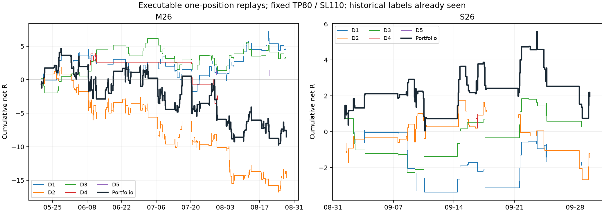
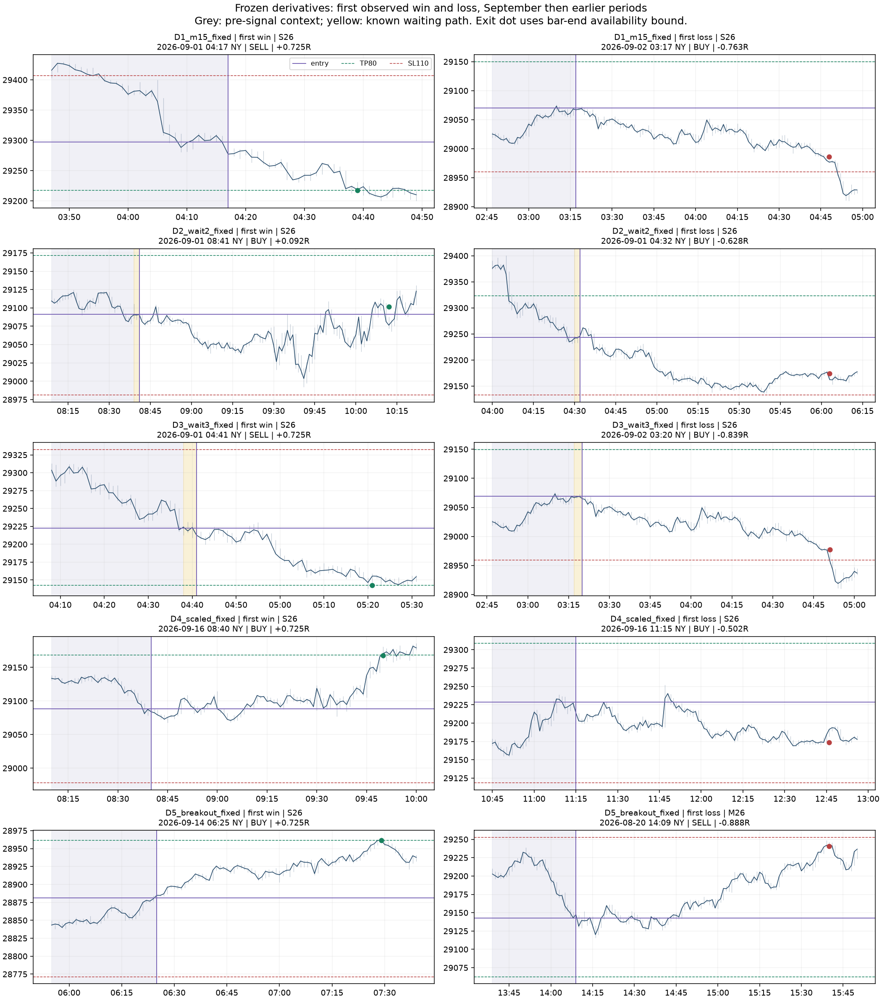

# Nasdaq: başarılı örneklerin mekanizmasından türetilen ikinci araştırma turu

Tamamlanma: **1 Ekim 2026**. İlk tanımlar ve seçim: 30 Eylül. Sembol NDX.INDX / MT5 NAS100; transfer kaynağı Dukascopy US100. Kullanıcının istediği ortak mantık → yeni fikir → karşılaştırmalı sınama zinciri uygulandı. Canlı bot, bayraklar ve emirler değiştirilmedi.

## Sonuç

**20 yeni türev tanımı sınandı; beş ailenin hiçbiri doğrulanmış yeni kâr kapısı olmadı.** En ilginç mekanizma D3'ün “bekle + gürültü bandı + fiyatı kovalamama” birleşimi; Mayıs–Ağustos ve Eylül toplamı pozitif, fakat 2025 ilk yarısı negatif, Eylül ikinci yarısı negatif, 3m aktarımı negatif ve ağır maliyetlere hassas. Bu nedenle araştırma hipotezi olarak kalır.

Yeni beşlinin tek-pozisyon portföyü 1–29 Eylül'de **73 karar / +1,97R**; Mayıs–Ağustos'ta **286 / −8,54R**. Eylül bootstrap %95 EV aralığı **[−0,131, +0,183]R**, pozitif bootstrap payı %63,49. Önceki +11,27R portföyün yerine geçecek kanıt üretmedi. 30 Eylül ek gününde donmuş portföy **5 / −0,38R** verdi.

R başlangıç stop mesafesine göre normalize edilmiş replay getirisidir. Simülasyon R'si, gerçek botun dolar kârı ve gelecekteki kâr aynı şey değildir.

## Ortak mantık nasıl çıkarıldı?

Önce gerçek işlem kazananları, kaybedenleri ve önceki araştırmada elenen fırsatlar aynı karar-anı özellikleriyle karşılaştırıldı. Ortak özellik ancak aynı strateji içinde anlamlıysa yeni fikre dönüştürüldü. Sırf kazananlarda bir özellik görünmesi nedensel fayda sayılmadı.

319 pozisyon bacağı → aynı dakika/yönde **317 bağımsız giriş kararı**. Bunların 316'sına taze kapalı-mum bağlamı eşlendi; 12 Temmuz 22:00 UTC'deki bir karar için yeterince taze mum yoktu. Kapsam 30 Haziran–29 Eylül, 46 karar günü. Giriş/önceki-kapanış fiyat farkı medyan 4,9 puan; saat kayması ±180/±1230 dakika alternatifleri çok daha kötü. Gerçek işlem puanı yönlü giriş/çıkış farkıdır; bacaklar eşit ağırlıklıdır. Lot, swap ve yönetilen stoplar nedeniyle bu puanlar gerçek R diye sunulmadı.

| Gerçek motor | Karar | WR | Puan/karar | Mekanizma yorumu |
|---|---:|---:|---:|---|
| MOM/SR | 21 | %42.9 | +3.87 | Farklı risk/yönetim; yeni kural testi değil |
| CHREV | 28 | %57.1 | -1.61 | Farklı risk/yönetim; yeni kural testi değil |
| VIXREG | 218 | %57.3 | +1.56 | Farklı risk/yönetim; yeni kural testi değil |
| DAYCOMBO | 29 | %75.9 | +34.59 | Farklı risk/yönetim; yeni kural testi değil |
| REENTRY | 18 | %88.9 | +58.74 | Farklı risk/yönetim; yeni kural testi değil |

**Yön + uygun giriş fiyatı** ortak bir tasarım fikridir; her motorda aynı EMA koşulu değildir. DAYCOMBO'nun 29/29 kararı M15 yönlü bağlamda; bu kendi kuralının parçası, bağımsız keşif sayılmaz. REENTRY'de yeniden hesaplanan H1 hizası 17/18; fakat 18 karar yeni bir kuralı kanıtlamaz. VIXREG'de ek M15 hizalı 115 karar −5,86 puan/karar, diğer 102 karar +11,03 (1 bağlam bilinmiyor): “daha çok trend teyidi her zaman daha iyi” varsayımı bu kohortta yanlış.

**Yeterli fiyat alanı** VIXREG'de daha belirgin: eksiksiz dört saatlik M1 pencere konumu BUY<0,60 / SELL>0,40 olan 92 karar +14,07 puan/karar; diğer 92 −6,92. Arada mum boşluğu olan 34 karar bu konum karşılaştırmasından çıkarıldı; bilinmeyenler kaybeden/uygunsuz sayılmadı. Bu eşikler zaten `forexsai_demo_bot.py::_position_gate_blocks` içinde mevcut; yeni kapı diye yeniden adlandırılmadı. DAYCOMBO devam stratejisinde aynı konum filtresi çoğu kazancı da elerdi. Bu bağlam karşılaştırmaları geçmiş işlemler üzerinde betimseldir; bloklandıktan sonra hangi yeni işlemlerin açılacağı bilinmez.

Kapalı H1 EMA50 burada uzun geçmişten yeniden hesaplandı. Botun sınırlı pencere EMA başlangıcı, geçmiş sürüm ve gerçek sinyal kuyruğu birebir yeniden üretilmedi; bu tablo bugün çalışan bayrağın etkisini ölçmez. Dönem/lot/strateji değişimleri vardır. Kodun kendi kuralını örneklerin ortak özelliği olarak bulmak yeni bağımsız kanıt değildir.

**Günlük stres ile mikro teyit aynı şey değildir.** Önceki günler düşmüşken SELL örnekleri daha zayıf olabilir; bundan doğrudan yeni BUY stratejisi çıkarılamaz. D4 bu ikinci adımı ayrıca sınadı.

**Portföy seçimi sonucu değiştiriyor.** Önceki varyans stratejisinin bağımsız Eylül sonucu −8,13R iken portföyün kabul ettiği 22 karar +7,30R idi. Ham 162 fırsat yeniden ayrıldı: kabul edilen 13 kırılım +7,74R, 9 dönüş −0,44R. H1/M15 hizası tek başına bu kazancı açıklamıyor. Diğer motorların doluluk takvimini gün içinde 500 kez nötr kaydırınca toplam R'nin %5/%50/%95 dilimleri −6,94/+0,85/+8,64 çıktı; tekrarların %8,4'ü +7,30R'ye ulaştı. Böyle bir alt küme ilginçtir, fakat aynı ayın sonuçlarından seçilmiştir; gelecekte uygulanabilir bir giriş kapısının kanıtı değildir. Kontrol tekrarlarının karar sayısı medyan 33, gerçek alt küme 22 olduğundan eşit risk/eşit hacimli bir alfa testi de değildir.

## Beş türev ve değişmeden kalan tanımlar

Tanımlar [PROTOCOL.md](PROTOCOL.md) içinde, kodda `experiment.py::candidates`. İlk üç seçim dönemi: 2025 H1/H2 ve saatleri düzeltilmiş Şubat–Mayıs 2026. Mayıs–Ağustos ve 1–29 Eylül yeniden sınamadır: bu tarihler önceki araştırmalarda görülmüştür, yeni bağımsız holdout olarak sunulmaz.

Her ailenin 2 varyantı × 2 çıkış geometrisi = 20 tanım. Üç seçim diliminde EV>0, toplam≥100, her dilim≥15 ve boşluk stresi≥0 arandı. Hiçbiri bütün şartları geçmedi. İnceleme için aile başına en iyi en-kötü-dilim EV'si seçildi; seçim başarısızlığı korunuyor. Ön seçimde küçük dilime konulan −10 sıralama cezası protokoldeki EV sıralamasıyla uyuşmadığı için Mayıs–Ağustos/Eylül türev etiketleri hesaplanmadan düzeltildi; ilk dosya `frozen_preliminary_ranking.json` içinde korundu.

Son seçilen beş tanımın hepsinde TP80/SL110, 90 dakika, 15:55 NY zorunlu çıkış var. CORE geometrisi de ilk 20 tanım içinde denenmişti; seçilmedi.

| Türev | Kesin ek koşul | Mayıs–Ağustos n / ΣR | Eylül n / ΣR | Eylül 3m / 5m ΣR | Karar |
|---|---|---:|---:|---:|---|
| D1 Yönlerin birleştiği geri çekilme | Efficient pullback30 + kapalı M15 yönü | 121 / +4.59 | 35 / -1.86 | +1.11 / +2.00 | RED; seçim şartları geçilmedi |
| D2 Geri alınan seviyenin kabulü | Failed-break60; 2dk sınırın içinde kapanışlar + ≤0,5ATR fiyat kovalamama | 213 / -14.63 | 48 / -1.45 | -1.60 / -1.95 | RED; seçim şartları geçilmedi |
| D3 Sabırlı ve fiyatı kovalamayan giriş | D1; 3dk bekle, aleyhe uç≤1,28ATR14√3, ilerleme≤0,5ATR70 | 79 / +3.39 | 26 / +0.26 | -0.76 / +2.48 | RED; seçim şartları geçilmedi |
| D4 Stres sonrası teyitli toparlanma | Failed-break60 BUY veya efficient-pullback30 BUY; önceki 5g z≤−1 + M15↑ | 31 / -3.01 | 3 / +0.95 | +1.24 / +0.42 | RED; seçim şartları geçilmedi |
| D5 Yol ve tetikleyici uyumu | Varyans kırılım dalı; VR5/120M1>1,2, ER60>0,2, 60dk yön hizası | 3 / +0.56 | 1 / +0.73 | +0.00 / +0.35 | RED; seçim şartları geçilmedi |

### Ana stratejiye gerçekten ne eklendi?

Toplam R farkı seçilen EV kadar önemlidir. Her iki akış kendi fırsatlarıyla tek pozisyon olarak tekrar yürütüldü; ayrı ayrı kabul/reddedilen alt akışlar birbirine eklenerek canlı portföy sayılmaz.

| Türev | Ön dönem kapısız / kapılı R | Eylül kapısız / kapılı R | Eylül toplam fark R | Gün-bloklu fark P(>0) | Holm(5) p |
|---|---:|---:|---:|---:|---:|
| D1 | +2.78 / +4.59 | +0.34 / -1.86 | -2.19 | %13.5 | 0.873 |
| D2 | -5.67 / -14.63 | -5.38 / -1.45 | +3.93 | %81.0 | 0.847 |
| D3 | +4.59 / +3.39 | -1.86 / +0.26 | +2.12 | %84.7 | 0.847 |
| D4 | +0.12 / -3.01 | -0.21 / +0.95 | +1.16 | %61.4 | 0.847 |
| D5 | +4.85 / +0.56 | -2.48 / +0.73 | +3.20 | %79.8 | 0.847 |

D3'ün Mayıs–Ağustos karşılaştırması özellikle öğretici: hemen giriş +4,59R; kör 3dk bekleme −1,76R; yalnız gürültü bandı +0,16R; band+fiyat sınırı +3,39R. Demek ki **bekleme tek başına faydalı değil**, birleşimin değeri gecikmeden çok hangi fiyattan kabul edildiğiyle ilişkili. Yine de +3,39R hemen girişin toplamını geçmedi. Eylül'de aynı dört sonuç −1,86/−0,89/+0,22/+0,26R. Bu, sebebin tüm dönemlerde aynı olduğunu kanıtlamaz.

D4'te Mayıs–Ağustos makro koşulu tek başına +3,57R; M15 koşulu tek başına +1,68R; ikisi birlikte −3,01R. İki pozitif özellik birleşince pozitif strateji oluşacağı varsayımı da yanlış. Eylül'deki üç pozitif kararın neti sadece **bir günden** geliyor. D5'te Eylül tek karar var; “%100 başarı” veya bootstrap %100 söylemi anlamlı değil.

### Belirsizlik, maliyet ve iki yarı

| Türev | Eylül WR / Wilson %95 | EV / gün-bloklu %95 | Etkin gün | İlk / ikinci yarı R | spread×1,5 / ×3 R | 1p kayma / +1dk R |
|---|---:|---:|---:|---:|---:|---:|
| D1 | %51.4 / %35.6–%67.0 | -0.053 / [-0.307, +0.186] | 16 | -1.71 / -0.15 | -1.95 / -2.45 | -2.25 / -1.03 |
| D2 | %45.8 / %32.6–%59.7 | -0.030 / [-0.183, +0.135] | 17 | +0.28 / -1.72 | -3.25 / -4.46 | -4.45 / -2.17 |
| D3 | %50.0 / %32.1–%67.9 | +0.010 / [-0.260, +0.288] | 15 | +0.51 / -0.25 | +0.19 / -0.81 | -0.04 / +0.41 |
| D4 | %66.7 / %20.8–%93.9 | +0.316 / tek gün; hesaplanamaz | 1 | +0.00 / +0.95 | +0.94 / +0.93 | +0.92 / +1.17 |
| D5 | %100.0 / %20.7–%100.0 | +0.725 / tek gün; hesaplanamaz | 1 | +0.73 / +0.00 | +0.73 / +0.73 | +0.72 / +0.34 |

Wilson bağımsız karar varsayımıyla betimseldir; gün içi bağımlılık için esas EV aralığı gün bloklarından gelir. Tek gün bootstrap'ı aynı günü tekrarlar, varyans öğrenemez; JSON'daki ham p=1 ve nokta aralığı anlamlı güven değildir. Bütün altı tarihsel kontrolün birlikte geçtiği aday sayısı **0**; hiçbir adayın Eylül hacmi 150 değil. Kapanıştan iyimser giriş farkı da ölçüldü; D3 bu duyarlılık kontrolünü geçmedi.

### Tek pozisyonla yeni beşli

| Dönem | n | Toplam R | EV R | DD R | Bootstrap pozitif payı |
|---|---:|---:|---:|---:|---:|
| D25a | 464 | +1.29 | +0.003 | 18.19 | %52.1 |
| D25b | 373 | -14.15 | -0.038 | 17.51 | %7.5 |
| C26 | 241 | +5.15 | +0.021 | 7.57 | %69.0 |
| M26 | 286 | -8.54 | -0.030 | 14.39 | %25.9 |
| S26 | 73 | +1.97 | +0.027 | 4.84 | %63.5 |
| Portföy kontrolü | Mayıs–Ağustos n / ΣR | Eylül n / ΣR |
|---|---:|---:|
| spread_1_5 | 286 / -10.83 | 72 / +0.11 |
| spread_3 | 288 / -14.42 | 73 / -0.76 |
| slip_1 | 286 / -13.14 | 72 / -1.29 |
| extra_delay_1m | 285 / -5.08 | 71 / +1.30 |
| tf_3 | 281 / +0.71 | 73 / +0.44 |
| tf_5 | 239 / +0.20 | 65 / +0.22 |

## Kurallar dondurulduktan sonraki 30 Eylül günü

1 Ekim'de mevcut MT5 köprüsünden **salt okunur** çekildi. Önce 29 Eylül çakışmasıyla saat/fiyat kontrol edildi. Donmuş kurallar, yönler, geometriler ve öncelik değişmedi. Bu çalışma için yeni gün kontrolüdür; diğer proje çalışmalarının aynı tarihteki veriyi hiç görmediği iddia edilmez.

M1 bar sayısı 1379; çakışma 1380, medyan/maksimum close farkı 0.000/0.000 puan. Broker UTC farkı 10800 saniye, point=0,1; spread dağılımı {'1.0': 1379}.

| Türev | Yeni gün n / R | 3m n / R | 5m n / R |
|---|---:|---:|---:|
| D1_m15_fixed | 1 / +0.725 | 2 / +0.252 | 1 / +0.725 |
| D2_wait2_fixed | 3 / -0.978 | 1 / +0.725 | 3 / +0.778 |
| D3_wait3_fixed | 0 / +0.000 | 1 / -0.657 | 1 / +0.725 |
| D4_scaled_fixed | 0 / +0.000 | 0 / +0.000 | 0 / +0.000 |
| D5_breakout_fixed | 1 / -0.129 | 1 / -0.129 | 0 / +0.000 |

Portföy 5 karar / **−0,382R**. D3 M1'de işlem üretmedi ve ana stratejinin bir kazancını kaçırdı. Tek günlük kazanç/kayıp bir stratejiyi doğrulamaya veya reddetmeye yetmez; bu sonucun ardından ayarlar yeniden seçilmedi.

## Saat onarımı ve önceki sonuca etkisi

Mart öncesi cache etiketleri 60 dakika erken. Ayrı H1 kaynağıyla kontrol: Şubat median close farkı kaydırmadan 28,9 puan; +60dk ile 2,2. Mart sonrası kaydırmadan 4,6; +60dk ile 35,6. Ayrıca kış cache'inde en güçlü dakika 08:30 NY görünürken düzeltmeyle 09:30'a gelir; normal Nasdaq nakit açılışı [09:30 ET](https://www.nasdaq.com/nasdaq-system-hours-of-operation). Ham dosya korunarak sadece bu turun okuma kopyası düzeltildi.

İlk turun beş kuralı aynı halde düzeltilmiş erken dönemde tekrar yürütüldü:

| İlk kural | Eski n / EV | Düzeltilmiş n / EV |
|---|---:|---:|
| exhaustion_60_none_buy | 267 / +0.1046 | 274 / +0.1049 |
| sweep_60_quiet_buy | 80 / +0.0747 | 78 / +0.0310 |
| failed_break_60_h1_both | 205 / +0.1024 | 204 / +0.1043 |
| efficient_pullback_30_efficiency_both | 129 / +0.1147 | 132 / +0.1011 |
| midpoint_reclaim_30_quiet_sell | 131 / +0.0826 | 129 / +0.0791 |

En belirgin fark süpürme örneğinde +0,0747→+0,0310R. İlk 432 adayın tamamı düzeltilmiş saatle yeniden seçilmedi: eski sıralamanın hâlâ aynı olduğu söylenemez. Buna karşılık ilk raporun Mayıs sonrası MT5, 2025 Dukascopy ve Eylül sonuçları bu kış-cache hatasından etkilenmez; önceki “beş kanıtlı kapı bulunamadı” sonucu değişmez.

## Yöntem ve doğrulama

Karar bar start+TF süresi geçince; giriş sonraki M1 açılışı. BUY ask, SELL bid; SELL çıkış ask, Dukascopy gerçek ask OHLC; MT5 bar-spread kaydı. 0,2 puan/fill, stop gap'inde kötü açılış, aynı bar TP/SL belirsizliğinde stop önce. Komisyon 0 yerel demo varsayımı; canlı hesap ücreti doğrulanmadı. Overnight yok. Risk gecikmiş yeni giriş anında belirlenir. NY03:00–15:30, Pazartesi–Perşembe, 15:55 flat; ≥10dk karar arası, tek pozisyon. Mevcut panel/model sinyalleri ve tüm canlı kapılar taklit edilmez.

Cache spread 1,3 puan yaklaşık. MT5 Eylül bar-spread'i sabit 1 puan; değişken tick/fill spread dağılımı ayrıca kanıtlanmış değil. Bu yüzden ×1,5/3 ve 1 puan/fill stresi kullanıldı. Boşluklar raporda ayrı ve en az −1R stresiyle görünür; son görülen kapanıştaki çıkış gerçek fill garantisi değildir. 1/3/5m aynı fiyat yoludur; bağımsız üç örneklem sayılmaz. VR120 ve diğer istatistiksel bağlamlar bütün trigger TF'lerinde M1 penceresidir.

Ana stratejiye karşı yürütme, reddedilen fırsat replay'i, ters yön, kör gecikme/band/makro/mikro ablasyonları; saat/yön başına aynı sayıda ham fırsatı kabul eden 300 rastgele kapı kontrolü yapıldı. Rastgele kapı işlenebilir karar sayısını/olay kümelenmesini değiştirebilir; tanısal plasebodur. Aynı günün gelecekte gerçekleşmiş ortalaması burada seçim metriği veya giriş özelliği değildir. Eski raporda bu ortalama karşılaştırma tanısıydı; onu bir giriş özelliğiyle karıştırmamak gerekir, fakat ileri taşınabilir alfa için yeterli taban da değildir.

20 aday tanımı + 114 kontrol hücresi = **134 sayım** (ilk arama dönemi çoğaltmaları ve ana/elenen tekrarları ayrıca aynı tanımın ölçümüdür). Yeni gün 5 ana + 10 TF ölçümü ve 1 portföy ekledi. 3000 rastgele kabul ve 500 doluluk takvimi tekrarı yeni strateji tanımı sayılmaz. Önceki 2052 arama değerlendirmesi ve diğer proje taramaları var; Holm(5) bütün bu geçmiş seçimi temizlemez. [Backtest overfitting çalışmasının](https://escholarship.org/uc/item/4w1110bb) işaret ettiği çoklu seçim sorunu nedeniyle tarihsel retest, yeni dönem kanıtının yerine geçmez.

20 tanım × 3 TF prefix-causality testi geçti; gelecekteki fiyatları değiştirmek geçmiş özellikleri değiştirmedi. Beş sentetik bekleme fikstürü, 10000 saat-tarihi eşitliği kontrolü geçti. Ortak motorun bid/ask, boşluk, stop önceliği, gerçek ask, alternatif risk/süre ve 432 eski tanımın prefix kontrolleri tekrar geçti. Tarihi biçimlendirmede local timezone çıkarma yalnız performans düzeltmesidir, 10000 tarihte aynı günü üretir.

Grafikler seçilen tanımın Eylül'deki ilk kazanan/kaybedenini gösterir; kaybeden yoksa önceki dönemden ilk kaybeden alınır ve dönem yazılır. D5 kaybedeni Mayıs–Ağustos döneminden gelir. Mor: gerçekçi giriş, yeşil/kırmızı: TP/SL; gri: sinyal öncesi görülen bağlam; sarı: bekleme sırasında bilinen yol. Çıkış noktası M1 içi kesin zaman yerine barın bitiş sınırında. Bunlar betimleyici grafiktir.

## Araştırmadan çıkan uygulanabilir karar

Yeni evrensel trend filtresi eklemek yerine **hangi motorun hangi fiyattan girdiği** ölçülmeli. Bu turda D3 mekanizması sonraki kapalı-mum niyetleri üzerinde, kendi ana stratejisi ve kör gecikmeyle yan yana, aynı risk ve işlem kapasitesiyle ölçülmeye değer. D4/D5 çok seyrek; düşük örnekli pozitif hücreler öne çıkarılmamalı. Bu beşli canlıya eklenmez; önceki donmuş portföyün gölge doğrulama backlog'u devam eder. Araştırma işi tamamlandı; gerçekten sonraki ≥150 karar/tick-fill doğrulaması henüz gerçekleşmedi. Hiçbir yeni gölge/canlı süreç başlatılmadı.

Tekrar üretim: `experiment.py search` → `experiment.py evaluate`; `verify.py`; `occupancy.py`; `forward_day.py`; `make_report.py`. Yeni gün ham export'u yoksa `pull_day.py` yalnız okuma köprüsünü kullanır; var olan çekimi üzerine yazmaz. Rapor, tanımlar, kayıtlar ve kaynak hash'leri `results/provenance.json` içinde izlenebilir.
