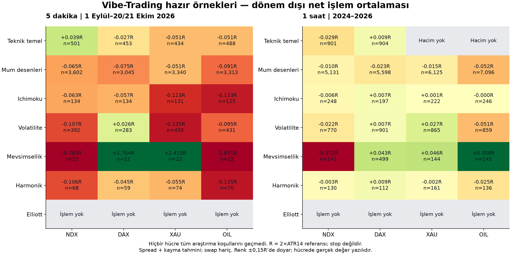
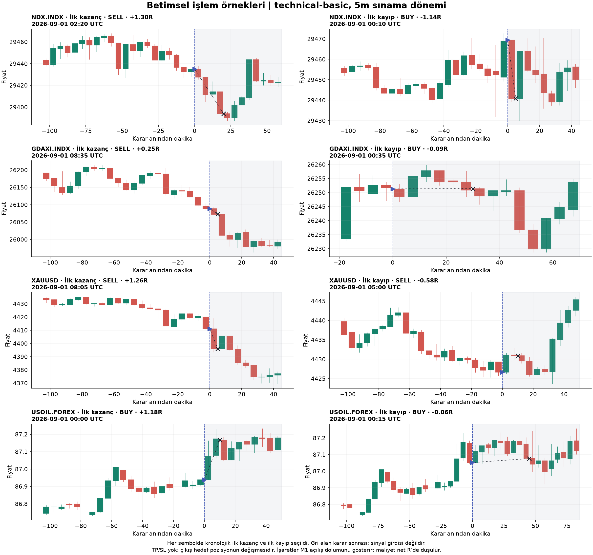

# Vibe-Trading — ForexSAI verileriyle nedensel sınama

Tarih: 22 Ekim 2026. **Sonuç: 54 hücrenin hiçbirinde tüm araştırma koşulları sağlanmadı; canlıya uygunluk kanıtı yok.**
Bu sonuç yalnız aşağıdaki hazır örneklere ve tanımlanmış icraya aittir; Vibe-Trading ile üretilebilecek bütün stratejiler hakkında hüküm değildir.

Kaynak: [HKUDS/Vibe-Trading](https://github.com/HKUDS/Vibe-Trading),
[sabit commit](https://github.com/HKUDS/Vibe-Trading/tree/11cff3f3a2d89605c89148b03dcc2dd0fcfb60db).
MIT lisanslı kod indirildi, 109 kaynak dosyası Git blob kimliğiyle doğrulandı;
[sıkıştırılmış kaynak](source_snapshot.tar.gz), [kaynak manifestosu](results/source_manifest.json).

## Ne sınandı?

Görseldeki ürün tek bir dondurulmuş işlem kuralı değildir; LLM, veri araçları, strateji örnekleri ve backtest motoru içeren bir çerçevedir.
Bu çalışma **orijinal yedi deterministik SignalEngine örneğini** varsayılan parametrelerle çalıştırdı.
LLM ajan takımı, haber tarama, dış MCP araçları ve otomatik emir yürütme bu testin parçası değildir.
Eski bir tarihi güncel LLM prompt'una yazmak modelin eğitimindeki gelecek bilgisini silmez; o yüzden bu rapor geçmiş LLM karar performansı iddia etmez.
İndirilen README/skill talimatları kaynak malzeme kabul edildi; proje talimatlarını geçersiz kılmadı.

Yedi örnek: teknik temel (EMA/ADX + BB/RSI + OBV), mum desenleri, Ichimoku, volatilite,
mevsimsellik, harmonik (yerleşik fallback), Elliott. İki frekans × dört sembol × yedi örnek = 56;
uzun XAU/OIL teknik temelde hacim yok → **54 geçerli test hücresi**. Bunların 46'inde test işlemi oluştu;
Elliott'un 8 hücresinde varsayılan kuralla işlem oluşmadı. Parametre optimizasyonu: **0**.

Frekans aktarımı açıkça yapıldı: örnekteki 20 bar, 5m'de 100 dakika, 1h'de 20 saattir; 20 günlük kuralın aynı olduğu iddia edilmiyor.
0=FLAT, +1=BUY, −1=SELL hedef pozisyonudur. Ichimoku/harmonik olayından sonra gelen 0 konumu kapatır;
karşıt sinyale kadar tutma veya sonradan TP/SL ekleme yapılmadı. Tüm örnekler aynı sözleşmeyle sınandı.

## Gelecek bilgisi denetimi

- İlk 800 yakın dönem barında dört sembol × yedi örnek = **28/28** prefix/gelecek değiştirme denetimi geçti.
  Toplam 187,251 geçmiş sinyal değeri karşılaştırıldı.
- Asıl veri üzerinde erken/orta/son önekler: **162/162** geçti.
- Harmonik ve Elliott sağ taraftan teyit gerektiren pivotları teyit barına geciktiriyor; kodda merkezli pencere bulunması tek başına sızıntı sayılmadı.
- **cross-market-strategy sızıntılı:** `_vol_adjust`, son 20 barın volatilitesinin son değerini bütün geçmişin ağırlığı yapıyor.
  Aynı anda dört sembol verildiğinde önek kısalınca geçmiş ağırlıkları değişti; 35 hata kaydı oluştu.
  Gelecek fiyat/hacim pertürbasyonu geçmiş çıktıyı da değiştirdi. Bu örnek performans tablolarına alınmadı.
- Aynı örneğin sembol tanıması bu dört CFD ismini `a_share` varsayıyor. ForexSAI sembol/spec adaptörü olmadan varsayılan motor seçimine güvenilmedi.

Bunlar dinamik örneklem denetimidir; tüm olası girdiler için matematiksel ispat değildir.
[İlk denetim](results/causality.json), [tam veri önekleri](results/full_prefix_checks.json),
[sızıntılı kaynak](upstream/agent/src/skills/cross-market-strategy/example_signal_engine.py).

## Veri ve saat ekseni

Yakın dönem: mevcut `indicator_snapshots` 1m yerel cache; 16/17 Haziran–20/21 Ekim 2026.
Eski broker saatlerine projenin `normalize_snapshot_clock` düzeltmesi uygulandı (28 Temmuz öncesi −3 saat;
18:00–21:00 belirsiz geçişi at). Her sembolün son M1 kaydı çıkarıldı.
5m mumları yalnız beş dakikanın tamamı varsa oluştu; sağ kenar kapanış damgalı.

Uzun 1h: NDX 2016–2026, DAX 2019–2026; XAU/OIL 2016–2 Eylül 2026, yalnız broker kaynaklı.
Yahoo vadeli emtia uzantısı dışlandı. İki veri ailesi birleştirilmedi.
Kullanılan bütün dosyalarda yinelenen zaman ve geçersiz OHLC sayısı **0**.

| Sembol | Veri | Bar | Başlangıç UTC | Son kapanış UTC |
| --- | --- | --- | --- | --- |
| NDX.INDX | recent_5m | 23,553 | 2026-06-16 21:20 | 2026-10-20 15:10 |
| NDX.INDX | long_1h | 59,828 | 2016-05-29 23:00 | 2026-07-14 23:00 |
| GDAXI.INDX | recent_5m | 20,396 | 2026-06-17 00:35 | 2026-10-21 02:10 |
| GDAXI.INDX | long_1h | 43,680 | 2019-01-02 07:00 | 2026-10-02 04:00 |
| XAUUSD | recent_5m | 23,507 | 2026-06-16 21:25 | 2026-10-20 14:30 |
| XAUUSD | long_1h | 60,630 | 2016-05-31 10:00 | 2026-09-02 23:00 |
| USOIL.FOREX | recent_5m | 23,653 | 2026-06-16 21:20 | 2026-10-20 23:30 |
| USOIL.FOREX | long_1h | 60,631 | 2016-05-31 07:00 | 2026-09-02 23:00 |

Saat çapraz kontrolü: uzun saatlik veri ile normalize M1→1h kesişiminde en düşük medyan kapanış farkı dört sembolde de **0 dakika** kaymada.
NDX/DAX/XAU medyan fiyat farkı 0; OIL'de 0,379 fiyat birimi baz farkı var. OIL geçmişlerini birleştirmemek bu yüzden de gerekli.
Bu denetim saat uyumunu destekler, iki fiyat kaynağının birebir aynı olduğu anlamına gelmez.
[Tam veri denetimi ve hash'ler](results/data_audit.json), [saat karşılaştırması](results/clock_overlap.json).

## İcra ve ölçüm

Karar yalnız kapanmış barla. Yakın testte giriş/çıkış ilgili karar anındaki **sonraki M1 açılışı**;
sinyali oluşturan 5m barın kapanış fiyatından dolum yapılmıyor. Gerekli açılış yoksa yeni giriş yok.
Uzun 1h'de sonraki 1h açılışı kullanıldı: bu kısım M1 doğrulaması değildir.
Tek pozisyon/sembol/örnek; ters sinyalde kapat ve yeni yön aç. Gelecek fiyatı büyüklük seçmekte kullanma.

Tam spread varsayımı: NDX 1,5 puan, DAX 1,5 puan, XAU 0,25$, OIL 0,03$.
Dolum başına ek 0,1×spread kayma → işlemde toplam 1,2×spread. Stres tüm maliyetin ×1,5'i.
Tarihsel gerçek bid/ask, komisyon ve swap kayıtları yok; sonuçlar **tahmini maliyetlidir**, gerçek broker neti değildir.
Gecelik taşımalarda eksik swap özellikle önemlidir.

Veri boşluğunu önceden bilip önceki kapanıştan kaçış yok: açık pozisyon boşluktan sonraki ilk gözlenen açılışta kapanır.
Değerlendirme sonu kapanışları ayrı etiketlidir. Fiyat boşlukları ve endpoint kapatmaları [işlem CSV'sinde](results/trades.csv) görünür.
Barlar arası gizli likidite/kayma ve stop içi yol simüle edilmez.

R = karar anındaki **2×ATR14 fiyat mesafesi**. Örneklerde gerçek SL/TP yoktur; R risk referansıdır,
−1R'de çıkış garantisi değildir. Toplam R, gerçek sermaye getirisi değildir; DD yalnız kapanmış işlem R eğrisidir,
pozisyon içi mark-to-market DD ve sermaye/marj modelini içermez. bp, işlem başlangıç fiyatına göre net baz puandır (1 bp=%0,01).

Geliştirme/sınama: uzun veride 2024-01-01, yakın veride 2026-09-01. Açık işlemler sınırdan taşınmaz;
ısınma fiyatları kullanılabilir, etiket/sonuçlar kullanılmaz. Bu fiyat geçmişleri başka proje araştırmalarında da görüldü;
"ilk kez görülen bağımsız piyasa" iddiası yok.

Gün-blok bootstrap 2.000 tekrar; Wilson %95 WR aralığı. Plasebo: aynı giriş/çıkış yolu ve masraf üzerinde
**gün bazında rastgele yön çevirme**, 10.000 tekrar. Bu kontrol yön katkısını sınar;
aynı yön/saatte rastgele başka girişlerin tam bir zamanlama kontrolü değildir.
Buy-and-hold ayrıca hesaplandı; maruziyet/tutuş eşit olmadığı için doğrudan üstünlük kanıtı değildir.
54 test hücresine Holm düzeltmesi; sonuçtan sonra en iyiyi seçip doğrulandı deme yok.
İlk 1.000 plasebonun Holm eşiğine sayısal olarak yetmemesi düzeltmesi ön kaydın EK-2'sinde açıklandı.

## Dönem dışı sonuçların tamamı

**Hiçbir hücre Holm kontrol eşiğini geçmedi. 0/54 araştırma adayı.**
N>0 olan 46 hücrenin 13'inde ortalama R pozitif;
pozitif ortalama tek başına tekrarlanabilir üstünlük değildir. Elliott'da işlem olmaması performans kanıtı değildir.

### Yakın 5m — 1 Eylül–20/21 Ekim 2026

| Sembol | Örnek | n | WR % | Ort net R | Net bp/işlem | Stres R | DD R | EV %95 aralık |
| --- | --- | --- | --- | --- | --- | --- | --- | --- |
| NDX.INDX | technical-basic | 501 | 35.7 | +0.039 | +0.15 | +0.018 | +17.2 | [-0.042, +0.128] |
| NDX.INDX | candlestick | 3602 | 39.5 | -0.065 | -0.93 | -0.088 | +236.6 | [-0.079, -0.051] |
| NDX.INDX | ichimoku | 134 | 41.8 | -0.063 | -1.13 | -0.085 | +8.7 | [-0.113, -0.015] |
| NDX.INDX | volatility | 392 | 46.4 | -0.107 | -1.24 | -0.129 | +69.8 | [-0.297, +0.100] |
| NDX.INDX | seasonal | 22 | 36.4 | -0.783 | -20.34 | -0.807 | +43.1 | [-4.582, +2.475] |
| NDX.INDX | harmonic | 68 | 41.2 | -0.106 | -1.53 | -0.128 | +7.8 | [-0.195, -0.032] |
| NDX.INDX | elliott-wave | 0 | — | — | — | — | — | — |
| GDAXI.INDX | technical-basic | 453 | 34.0 | -0.027 | -0.75 | -0.056 | +31.7 | [-0.128, +0.074] |
| GDAXI.INDX | candlestick | 3045 | 39.5 | -0.075 | -0.92 | -0.106 | +232.5 | [-0.089, -0.061] |
| GDAXI.INDX | ichimoku | 134 | 45.5 | -0.057 | -0.88 | -0.086 | +11.4 | [-0.121, +0.021] |
| GDAXI.INDX | volatility | 283 | 49.5 | +0.026 | +0.06 | -0.003 | +20.5 | [-0.159, +0.206] |
| GDAXI.INDX | seasonal | 22 | 40.9 | +1.764 | +16.41 | +1.730 | +15.2 | [-1.300, +5.179] |
| GDAXI.INDX | harmonic | 59 | 37.3 | -0.045 | -0.59 | -0.075 | +3.4 | [-0.115, +0.032] |
| GDAXI.INDX | elliott-wave | 0 | — | — | — | — | — | — |
| XAUUSD | technical-basic | 434 | 36.6 | -0.051 | -1.35 | -0.068 | +27.3 | [-0.120, +0.014] |
| XAUUSD | candlestick | 3340 | 41.3 | -0.051 | -1.01 | -0.068 | +171.4 | [-0.069, -0.033] |
| XAUUSD | ichimoku | 131 | 34.4 | -0.123 | -2.74 | -0.141 | +16.8 | [-0.205, -0.042] |
| XAUUSD | volatility | 430 | 44.9 | -0.135 | -2.32 | -0.154 | +63.0 | [-0.252, -0.026] |
| XAUUSD | seasonal | 22 | 72.7 | +2.410 | +29.21 | +2.389 | +21.6 | [-0.531, +5.348] |
| XAUUSD | harmonic | 74 | 41.9 | -0.055 | -1.12 | -0.073 | +4.3 | [-0.134, +0.023] |
| XAUUSD | elliott-wave | 0 | — | — | — | — | — | — |
| USOIL.FOREX | technical-basic | 488 | 36.1 | -0.051 | -2.62 | -0.095 | +29.3 | [-0.124, +0.026] |
| USOIL.FOREX | candlestick | 3313 | 35.2 | -0.091 | -3.65 | -0.139 | +302.7 | [-0.105, -0.080] |
| USOIL.FOREX | ichimoku | 125 | 33.6 | -0.133 | -5.59 | -0.182 | +16.6 | [-0.191, -0.077] |
| USOIL.FOREX | volatility | 431 | 41.5 | -0.095 | -4.63 | -0.141 | +47.3 | [-0.228, +0.047] |
| USOIL.FOREX | seasonal | 22 | 45.5 | -1.851 | -37.27 | -1.900 | +62.3 | [-5.268, +1.491] |
| USOIL.FOREX | harmonic | 70 | 30.0 | -0.135 | -5.66 | -0.182 | +9.5 | [-0.218, -0.053] |
| USOIL.FOREX | elliott-wave | 0 | — | — | — | — | — | — |

### Uzun 1h — 2024 ve sonrası

| Sembol | Örnek | n | WR % | Ort net R | Net bp/işlem | Stres R | DD R | EV %95 aralık |
| --- | --- | --- | --- | --- | --- | --- | --- | --- |
| NDX.INDX | technical-basic | 901 | 36.7 | -0.029 | -2.31 | -0.036 | +43.9 | [-0.082, +0.028] |
| NDX.INDX | candlestick | 5131 | 44.9 | -0.010 | -0.43 | -0.018 | +53.7 | [-0.021, +0.001] |
| NDX.INDX | ichimoku | 248 | 49.2 | -0.006 | -0.61 | -0.014 | +6.6 | [-0.046, +0.036] |
| NDX.INDX | volatility | 770 | 48.8 | -0.022 | -3.24 | -0.030 | +35.7 | [-0.118, +0.068] |
| NDX.INDX | seasonal | 141 | 44.7 | -0.372 | -32.49 | -0.380 | +78.8 | [-0.994, +0.247] |
| NDX.INDX | harmonic | 130 | 48.5 | -0.003 | +0.54 | -0.010 | +4.0 | [-0.056, +0.046] |
| NDX.INDX | elliott-wave | 0 | — | — | — | — | — | — |
| GDAXI.INDX | technical-basic | 904 | 40.5 | +0.009 | -0.67 | +0.000 | +18.2 | [-0.038, +0.057] |
| GDAXI.INDX | candlestick | 5598 | 45.1 | -0.023 | -1.12 | -0.032 | +144.2 | [-0.033, -0.013] |
| GDAXI.INDX | ichimoku | 197 | 46.7 | +0.007 | -0.04 | -0.003 | +4.3 | [-0.042, +0.056] |
| GDAXI.INDX | volatility | 901 | 48.2 | +0.007 | -0.39 | -0.002 | +35.7 | [-0.058, +0.075] |
| GDAXI.INDX | seasonal | 499 | 50.1 | +0.043 | +0.18 | +0.035 | +36.3 | [-0.115, +0.204] |
| GDAXI.INDX | harmonic | 112 | 46.4 | +0.009 | +0.98 | +0.000 | +3.6 | [-0.038, +0.057] |
| GDAXI.INDX | elliott-wave | 0 | — | — | — | — | — | — |
| XAUUSD | candlestick | 6125 | 45.9 | -0.015 | -0.75 | -0.024 | +105.6 | [-0.025, -0.005] |
| XAUUSD | ichimoku | 222 | 46.4 | +0.001 | -0.51 | -0.009 | +5.4 | [-0.049, +0.053] |
| XAUUSD | volatility | 865 | 48.0 | +0.027 | +4.16 | +0.018 | +25.1 | [-0.047, +0.101] |
| XAUUSD | seasonal | 144 | 56.2 | +0.046 | +5.19 | +0.036 | +40.2 | [-0.539, +0.657] |
| XAUUSD | harmonic | 161 | 47.8 | -0.002 | -1.27 | -0.012 | +4.7 | [-0.047, +0.043] |
| XAUUSD | elliott-wave | 0 | — | — | — | — | — | — |
| USOIL.FOREX | candlestick | 7096 | 40.1 | -0.052 | -5.15 | -0.077 | +375.8 | [-0.061, -0.042] |
| USOIL.FOREX | ichimoku | 246 | 46.7 | -0.000 | +0.44 | -0.024 | +5.2 | [-0.041, +0.041] |
| USOIL.FOREX | volatility | 859 | 47.8 | -0.051 | -3.32 | -0.076 | +70.3 | [-0.125, +0.021] |
| USOIL.FOREX | seasonal | 145 | 55.9 | +0.308 | +53.85 | +0.284 | +33.3 | [-0.248, +0.892] |
| USOIL.FOREX | harmonic | 136 | 40.4 | -0.025 | -3.20 | -0.050 | +5.5 | [-0.063, +0.012] |
| USOIL.FOREX | elliott-wave | 0 | — | — | — | — | — | — |

Pozitif istisnaları güçlü kanıt diye yorumlamamak gerekir:

- NDX teknik temel 5m: +0,039R, 501 işlem, WR %35,7; stres +0,018R, yalnız +0,15 bp/işlem.
  Aynı örneğin uzun 1h sınaması −0,029R. Bağımsız, maliyete dayanıklı üstünlük kanıtı oluşmadı.
- XAU mevsimsellik 5m: WR %72,7 ama yalnız 22 işlem. DAX mevsimsellik de 22 işlem.
  Küçük örnek, gecelik taşıma ve kontrol testi yüzünden bu satırlar aday değil.
- OIL mevsimsellik 1h: +0,308R, 145 işlem; asgari 150 test işlemi yok ve çoklu kontrol anlamlı değil.
- DAX'ta bazı R-pozitif satırların net bp ortalaması negatiftir: ATR'yle risk ağırlığı değişince ölçüm ağırlıkları değişir.
  Bu, tek başına "kâr eden lot stratejisi" olarak okunamaz.

[Geliştirme + sınama özet CSV](results/summary.csv), [yön dökümü](results/by_side.csv),
[yıl dökümü](results/by_year.csv), [buy-and-hold](results/buy_hold.csv),
[koşul kartları](results/research_cards.json), [tüm varsayımsal işlemler](results/trades.csv).
Farklı strateji/frekans satırları ortak fiyat geçmişi kullandığından tek bir portföy veya bağımsız işlem havuzu gibi toplanamaz.

## Kazanç/kayıp örnekleri

Her sembolde teknik temel 5m sınamasının kronolojik **ilk kazancı ve ilk kaybı** seçildi.
Bunlar açıklayıcı grafiklerdir; kuralın doğruluğunun kanıtı değildir. Gri alan karar sonrası yoldur;
sinyal bu veriyi görmedi. TP/SL olmadığı grafikte açıkça belirtilmiştir.

## Orijinal motorun çalışabilirliği

Orijinal upstream ForexEngine, her sembolde son 800 yerel 5m bar üzerinde teknik temel örneğiyle
çalıştırıldı. CFD fiyat/spread ve miktar birimleri küçük bir LocalCFD adaptörüyle açıkça tanımlandı;
Forex paritesi varsayılan pip/lot sayıları endekslere uygulanmadı. Hesap bağlantısı yok, swap kapalı.
Bu çalışabilirlik kontrolüdür; ayrı tarih aralığı ve sermaye modeli nedeniyle ana R tablosuyla aynı sonuç beklenmez.

| Sembol | Başarılı | Kapanmış işlem | Dolum |
| --- | --- | --- | --- |
| NDX.INDX | True | 34 | 68 |
| GDAXI.INDX | True | 38 | 76 |
| XAUUSD | True | 24 | 48 |
| USOIL.FOREX | True | 42 | 84 |

[Native motor kanıtı](results/native_smoke.json), [orijinal motor çıktıları](results/native/).

## Diğer örneklerin kapsam durumu

| Örnek | Kapsam / neden |
| --- | --- |
| technical-basic | performance: unmodified default; long XAU/OIL missing volume |
| candlestick | performance: unmodified default |
| ichimoku | performance: unmodified default; target=0 closes position |
| volatility | performance: unmodified default |
| seasonal | performance: unmodified default; UTC calendar |
| harmonic | performance: built-in fallback; right-confirmation audited |
| elliott-wave | performance: right-confirmation audited |
| cross-market-strategy | REJECTED: future-dependent weights; unrecognized CFD symbols route to a_share |
| minute-analysis | analysis-only: no SignalEngine |
| event-driven | unsupported: no point-in-time historical event_score |
| fundamental-filter | unsupported: CFD symbols lack stock PE/PB/ROE statements |
| options-strategy | unsupported: no historical options chain/contract/fills |
| pair-trading | not scored: no preregistered pair/hedge; default does not evaluate all 4 symbols |
| multi-factor | not scored: cross-sectional allocation; default top_n=5 >= universe=4; not a single-symbol directional engine |
| smc | not executed: optional smartmoneyconcepts missing; retrospective BOS/FVG assignment needs separate PIT audit |
| chanlun | not executed: optional czsc missing; separate incremental detector dependency |

SMC/Chanlun, bu çalışmada kurulup sınanmış gibi sunulmuyor. PIT haber, bilanço, opsiyon zinciri veya
önceden seçilmiş çift verisi olmayan örnekler için veri uydurulmadı.

## Teslim ve sonraki somut doğrulama

Yeniden çalıştırma: [README](README.md), [ön kayıt](PROTOCOL.md), [5 icra sözleşmesi testi](selftest.py).
Canlı bot, sinyal kapısı, strateji ayarı, deployment veya üretim veritabanı değişikliği yapılmadı.
Kaynak, kod ve rapor yerel araştırma klasöründe; Evolution kayıtları yalnız bu analizi kataloglar.

Tam LLM takımını değerlendirmek için sonraki geçerli deney, **gelecekte toplanacak gölge kararlar**dır:
model/sürüm/prompt sabitlenir; araçlar yalnız karar anında bilinen mum/haber döndürür; karar önceden
değiştirilemez kayda yazılır; broker bid/ask ve sonraki M1 dolum kaydedilir; en az 150 çözülmüş bağımsız
olaydan sonra proje go-live kartıyla değerlendirilir. Bu araştırma böyle bir deneyi başlatmadı ve LIVE kararı vermedi.
